# Nihility — Livro do Jogador

Nihility é um sistema modular de RPG. Este livro apresenta suas regras, exemplos e possibilidades de campanha. Os valores descritos como padrão são os de fábrica; as escolhas da mesa podem alterá-los.

**Conhecimento para jogar:** este livro apresenta o que você precisa para interpretar e usar sua ficha. Descobertas sobre o mundo são apresentadas pelo Mestre durante a campanha.

**Como ler:** primeiro vêm a proposta e a regra; depois, os exemplos e a consulta. Seções **No Foundry** identificam a operação do aplicativo. Os apêndices reúnem telas, campos e referências para usar durante a sessão. **Skill** e **Habilidade** são o mesmo termo. Exemplos narrativos não acrescentam regras obrigatórias.

## Sumário

- [1. Jogar Nihility](#1-jogar-nihility)
- [2. Criar um personagem](#2-criar-um-personagem)
- [3. Atributos e testes](#3-atributos-e-testes)
- [4. Habilidades e poderes](#4-habilidades-e-poderes)
- [5. Aprender e desenvolver Skills](#5-aprender-e-desenvolver-skills)
- [6. Equipamento e recursos](#6-equipamento-e-recursos)
- [7. Vida, energia e recuperação](#7-vida-energia-e-recuperação)
- [8. Combate e consequências](#8-combate-e-consequências)
- [9. Experiência e reconhecimento](#9-experiência-e-reconhecimento)
- [10. Anatomia e modificações corporais](#10-anatomia-e-modificações-corporais)
- [11. Ambiente, Estruturas e Antimagia](#11-ambiente-estruturas-e-antimagia)
- [12. Naves, veículos e tripulação](#12-naves-veículos-e-tripulação)
- [13. Comunicação e PAD](#13-comunicação-e-pad)
- [Apêndice A. A ficha no Foundry](#apêndice-a-a-ficha-no-foundry)
- [Apêndice B. Dúvidas durante a sessão](#apêndice-b-dúvidas-durante-a-sessão)
- [Apêndice C. Glossário](#apêndice-c-glossário)

<!-- LIVRO -->

## 1. Jogar Nihility

Uma passagem cedeu. A maré está subindo e ainda há alguém do outro lado. Lia procura um apoio para a corda; Cora examina a estrutura; Neris prepara uma Habilidade. Cada decisão muda a situação que o grupo terá de enfrentar em seguida.

Em **Nihility**, você interpreta um personagem e decide como ele age. O Mestre apresenta o mundo, interpreta as outras pessoas e resolve as consequências das tentativas do grupo. As regras entram quando é preciso descobrir o resultado de uma ação ou acompanhar seus efeitos.

O sistema é modular. Sua mesa pode explorar ruínas de fantasia, investigar uma cidade contemporânea, viajar entre estrelas ou combinar essas possibilidades. Antes de criar o personagem, descubra com o Mestre quais opções a campanha utiliza.

### A conversa na mesa

O Mestre descreve o que está ao alcance dos personagens. Você declara uma intenção e explica como pretende realizá-la. Faça perguntas quando precisar entender melhor o lugar, as pessoas ou o perigo. Se a tentativa exigir uma rolagem, o Mestre indica o Atributo e esclarece o que está em jogo.

> **Na passarela**
> Mestre: O piso cedeu no meio. Há cabos pendurados e o console ainda pisca do outro lado.
> Lia: Consigo alcançar um dos cabos com a corda?
> Mestre: Consegue lançar a corda até ele. O cabo parece preso à estrutura.
> Lia: Quero usá-lo para atravessar. Primeiro amarro a outra ponta no corrimão.
> Mestre: Certo. O vapor dificulta enxergar onde pisar. Role Destreza para a travessia.

A corda, o vapor e a posição dos companheiros importam porque mudam as opções e as consequências da cena. Diga o que faz; use a ficha para resolver a parte da tentativa que pede uma regra.

### Antes da primeira sessão

Combine com o grupo:

- **A proposta:** quem são os personagens e o que os mantém juntos?
- **O tom:** como aventura, humor, perigo e violência aparecerão na história?
- **Os limites:** quais temas ficam fora e como pedir uma pausa?
- **As opções:** haverá Anatomia, Naves, PAD, Escala ou outros subsistemas?
- **A criação:** quais Espécies, Habilidades e equipamentos estarão disponíveis?

### Cinco viajantes

Os exemplos acompanham cinco personagens. Seus hábitos e equipamentos ajudam a reconhecer quem está agindo e o que tenta conseguir.

**Neris, a maga.** Elfa de casaco azul-petróleo e trança curta marcada por fios brancos. É paciente para ensinar, mas custa a admitir que algo escapou à sua compreensão. Seu grimório reúne fragmentos de uma tradição mágica que procura reconstruir.

**Dra. Cora Nunes, a cientista.** Humana de cabelos grisalhos, jaqueta verde-oliva e estojos reaproveitados. Faz perguntas, compara evidências e revê hipóteses. Sua pesquisa foi interrompida pelo desaparecimento de uma equipe.

**Ícaro Vale, o explorador espacial.** Usa um traje cinza-claro com faixas ferrugem, peças substituídas e um capacete preso à mochila. Tem humor seco e confere as saídas ao chegar. Procura a origem de uma transmissão de uma nave considerada perdida.

**Lia, a exploradora.** Humana de casaco vermelho gasto, cabelo cacheado e caderno de campo. Recupera artefatos e segue pistas de uma expedição desaparecida. Sua curiosidade costuma chegar um pouco antes da prudência.

**Doran, o artesão.** Anão de barba grisalha, roupas de lã e ferramentas reparadas. Cozinha, conserta e percebe o cansaço dos companheiros. Viaja à procura da pessoa que recebeu uma peça feita por seu antigo mestre de ofício.

### Por onde começar

Leia **Criar um personagem**, **Atributos e testes** e **Habilidades e poderes**. Depois consulte equipamento, recursos e combate. Os capítulos de Anatomia, ambiente, Naves e PAD acompanham as opções da sua campanha. Os blocos **No Foundry** e os apêndices explicam os controles da ficha.

## 2. Criar um personagem

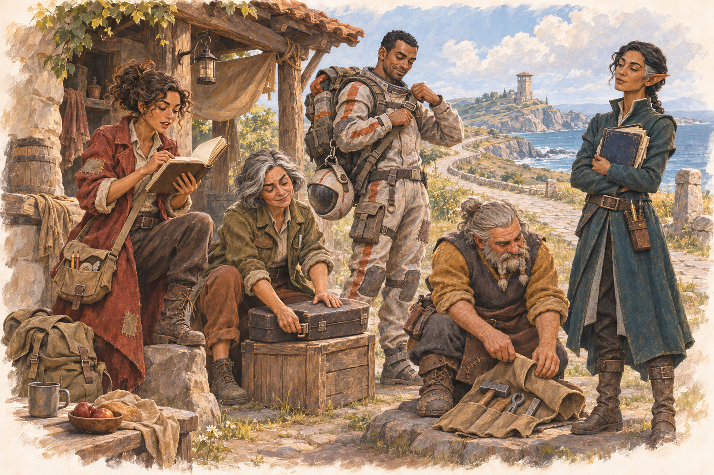

Escolha quem você quer interpretar, o que essa pessoa procura e por que vai acompanhar o grupo. Depois escolha sua origem, distribua os Atributos e combine as Habilidades e os recursos iniciais com o Mestre.

### Do conceito ao personagem

1. **Defina o conceito.** Escreva uma frase sobre a pessoa que quer interpretar e um objetivo que possa aparecer na aventura.
2. **Escolha a origem.** A Espécie diz o que você é; a Linhagem especifica uma variação; Heranças representam transformações ou acontecimentos adquiridos. Nem toda campanha usa todas essas camadas.
3. **Distribua os Atributos.** O padrão é 35 pontos no nível 1. Pense tanto nas tentativas que deseja fazer quanto nas fórmulas de Vida e Mana.
4. **Combine as Skills.** O padrão concede 3 Pontos de Habilidade Normais. Eles permitem fazer pedidos dentro das opções da mesa, não autorizam qualquer efeito sem revisão.
5. **Combine o equipamento.** Armas, proteção, suprimentos e recursos iniciais dependem da campanha. Este livro não concede um conjunto universal de itens gratuitos.
6. **Revise com o Mestre.** Confira origem, pontos, Habilidades e recursos antes da primeira cena.

### As camadas da origem

**Espécie** identifica o tipo de ser que o personagem é e pode definir Traços, poderes Raciais, corpo e outras características. **Linhagem** diferencia uma variação dentro dela. **Heranças** representam mudanças adquiridas, como uma transformação em vampiro ou a conversão em ciborgue, e são concedidas ou retiradas pelo Mestre.

Bônus de Atributo da origem entram no Total permanente e podem participar das fórmulas de Vida e Mana. Uma evolução de Espécie é uma transformação conduzida pelo Mestre; ela acrescenta possibilidades sem apagar os níveis das Skills Raciais que o personagem conservou.

### Exemplo de criação — Lia

Lia é uma exploradora humana que recupera artefatos antigos e procura uma expedição desaparecida. Sem Títulos, Heranças ou bônus adicionais, ela distribui seus 35 pontos assim:

| Atributo | Pontos | Rolagem sem outros bônus |
|---|---|---|
| Força | 6 | 1d20+2 |
| Defesa | 5 | 1d20+1 |
| Magia | 3 | 1d20+1 |
| Defesa Mágica | 3 | 1d20+1 |
| Destreza | 6 | 1d20+2 |
| Furtividade | 3 | 1d20+1 |
| Percepção | 5 | 1d20+1 |
| Precisão | 4 | 1d20+1 |

A soma é 35. Com as fórmulas padrão, Lia tem **300 de Vida** (6 × 5 × 10) e **90 de Mana** (3 × 3 × 10). Esses valores permitem acompanhar os cálculos do capítulo; você pode distribuí-los de outra maneira.

### No Foundry — Criar e liberar a ficha

#### Abrindo a sua ficha

Há dois caminhos:

- **Diretório de Atores** (a aba de Atores na barra lateral do Foundry): clique no nome do seu personagem.
- **Menu do sistema**: no topo do Diretório de Atores há o botão **Nihility RPG System**. Ele abre o Menu Principal, e a aba **Fichas** lista todos os Atores que você possui ou pode observar, com busca por nome e filtros (**Todos**, **Personagens**, **NPCs**, **Naves**, **Veículos**). As outras abas do menu aparecem com cadeado: são do Mestre.

#### Criando o personagem (ficha em modo criação)

Você cria o personagem **na própria ficha**, a mesma que vai usar a campanha inteira. Não há assistente em janela à parte.

1. No Menu › **Fichas**, clique **Criar personagem**. O Foundry não deixa jogador criar ficha, então o pedido vai para o Mestre conectado, que cria uma ficha em branco já sua, sem precisar clicar em nada. Sem Mestre conectado, o botão fica apagado ("precisa do Mestre conectado"). Enquanto você tiver uma ficha em criação, o botão vira **Continuar** com o nome dela.
2. A ficha abre em **modo criação**: embaixo do cabeçalho aparece a faixa **Criando**, com o que falta. Cada item leva ao lugar certo quando clicado e fica marcado quando está pronto:
   - **Conceito**: uma frase sobre quem você quer jogar, no campo logo abaixo do nome. Não é regra e não trava nada; depois fica no topo da Biografia.
   - **Origem**: a Espécie (e a Linhagem, quando ela pede uma). Veja abaixo.
   - **Pontos**: quantos Pontos de Atributo você já distribuiu.
   - **Skills**: quantos Pontos de Habilidade já viraram Skill ou pedido.
3. Na aba **Origem**, a ficha mostra a **grade de Espécies** liberadas para criação, com busca e grupos. Clique numa para ver, ao lado, o que ela traz: Traços, o que o corpo tem de diferente, Skills Raciais (as que só chegam mais tarde aparecem apagadas, com o nível) e Resistências. Se ela tiver Linhagens, escolha uma embaixo. **Ficar com…** aplica.
4. Distribua os pontos na aba Ficha (veja [Alocando Pontos de Atributo](#alocando-pontos-de-atributo)). Em criação, o botão **Confirmar** não aparece: os pontos ficam pendentes até o Mestre liberar o personagem, e é a liberação que confirma tudo. Assim você pode mudar de ideia, e o Mestre pode pedir ajuste.
5. Peça as suas Skills (veja [Pontos de Habilidade](#5-aprender-e-desenvolver-skills)).
6. Clique **Pronto para jogar** na faixa. Basta ter nome e Espécie; ponto sobrando ou Skill não pedida só aparecem em amarelo, sem travar. O Mestre recebe um aviso na tela.
   - A faixa vira **Aguardando o Mestre**. Você ainda pode mexer: ele vê a versão mais nova. **Voltar a editar** desfaz o "pronto".
   - Se o Mestre pedir um ajuste, a faixa vira **Ajuste pedido** com o recado dele, e um aviso aparece na sua tela. Ajuste e clique **Pronto de novo**.
   - Quando o Mestre libera, a faixa some, os pontos passam a valer, a Espécie trava e a Vida e a Mana enchem. A Voz do Mundo avisa: "Kael está pronto para jogar".

Em criação, a aba **Anatomia** fica escondida; ela volta quando o personagem é liberado. O Mestre também pode pôr uma ficha que já existe em modo criação (para refazer um personagem na sessão zero, por exemplo); nada é apagado.

Se a sua mesa desligou o modo criação, a ficha funciona como descrito no resto deste capítulo: Espécie no cabeçalho e **Confirmar** nos pontos.

#### Escolhendo a Espécie (e a Linhagem)

Em modo criação, a Espécie se escolhe pela grade da aba Origem (veja acima). Fora dele, um personagem novo começa com a Espécie em branco (**—**): escolha no seletor do cabeçalho. Se a Espécie tiver **Linhagens** (Dragoide do Fogo/Gelo/Raio, Elfo Alto/da Floresta/Sombrio…), aparece um segundo seletor ao lado; o asterisco indica que escolher uma é obrigatório.

Na criação, a escolha vale na hora: o sistema cria as **Partes do Corpo** (cada uma com Vida própria, se a mesa usa Anatomia), as **Skills Raciais** e aplica os **Traços** e os bônus da Espécie. Se a ficha já tiver algo da Espécie anterior, abre uma **prévia** mostrando o que entra, muda e sai antes de gravar — **Cancelar não muda nada**.

**Você pode trocar até confirmar seus primeiros Pontos de Atributo** (em modo criação, até o Mestre liberar o personagem). No primeiro "Confirmar" a origem trava, e daí em diante só o Mestre troca (pela aba **Origem**). Algumas Espécies (montarias, formas evoluídas) só aparecem para o Mestre.

Espécies que vêm prontas:

| Grupo | Espécies |
|---|---|
| Fantasia | Humano, Elfo, Anão, Orc, Goblin, Pequenino |
| Isekai | Slime, Dragoide, Ogro, Lobo Tempestade, Harpia (e as evoluções Slime Demoníaco e Kijin) |
| Sci-Fi | Ciborgue, Androide, Mutante, Simbionte |

O Mestre pode ter criado outras ou removido estas.

#### A aba Origem

Mostra de onde o personagem vem, em camadas:

- **Espécie** — o que você é. Traços, elemento do corpo, carga, Escala, Deslocamento e bônus valem **ao vivo** (se o Mestre editar a Espécie, muda na hora); Partes do Corpo e Skills Raciais são **copiadas** para a ficha, com Vida, nível e XP próprios.
- **Linhagem** — que tipo daquela Espécie você é.
- **Heranças** — o que aconteceu com você (Vampirizado, Meio-Dragão, Convertido em Ciborgue…). Só o Mestre dá e tira, e o anúncio chega pela Voz do Mundo.
- **Histórico** — trocas, evoluções e Heranças, com data.

Bônus de atributo da origem entram no **Total** do atributo, como um Título (e por isso na Vida/Mana máxima). O ⓘ ao lado de cada atributo mostra a parcela como "Espécie: Ogro", "Linhagem: …", "Herança: …".

Se a sua Espécie puder **evoluir** (estilo Tensura: Slime → Slime Demoníaco, Ogro → Kijin), o Mestre faz isso pela aba Origem. Evoluir **soma**: suas Skills Raciais continuam com o nível que tinham.

#### Distribuindo os pontos iniciais

No nível 1 você tem **35 Pontos de Atributo** para distribuir entre os Atributos, e **3 Pontos de Habilidade Normais** para pedir Skills. Os dois processos estão explicados em [Distribuir pontos](#alocando-pontos-de-atributo) e [Aprender e desenvolver Skills](#5-aprender-e-desenvolver-skills).

---

## 3. Atributos e testes

Os Atributos descrevem capacidades gerais. Uma rolagem entra quando o Mestre precisa resolver uma tentativa incerta; a escolha do Atributo acompanha aquilo que o personagem está tentando fazer.

### Os oito Atributos

**Atributos** são características gerais do personagem, expressas em números: sua força física, sua atenção, seu domínio da magia e assim por diante. Eles ajudam a representar como você enfrenta uma situação. Uma **Habilidade** ou **Skill**, por sua vez, é um recurso específico que o personagem possui, como um poder, uma técnica ou uma resistência.

Um personagem pode ter muita Força e pouca Precisão: conseguir mover algo pesado não significa conseguir acertar um alvo pequeno. Também pode ter muita Magia e pouca Defesa Mágica: produzir efeitos mágicos e suportar magia são capacidades diferentes.

#### Força — Potência física

Força representa o esforço muscular: erguer uma viga, empurrar uma porta ou sustentar um companheiro. Doran usa sua força para manter uma passagem aberta enquanto Lia atravessa.

O Total de Força participa da Vida máxima e pode servir de Atributo de Escala de um golpe, quando a arma ou a Skill usa esse atributo.

#### Defesa — Robustez física

Defesa representa a robustez do corpo e sua capacidade de suportar esforço. É relevante quando o personagem precisa aguentar uma situação fisicamente exigente.

Junto de Força, determina a Vida máxima. A redução do dano recebido é resolvida pelas defesas descritas no capítulo de combate; Defesa não funciona como Classe de Armadura.

#### Magia — Poder e domínio mágico

Magia representa a capacidade de conduzir poderes mágicos. Neris pode canalizá-los para alimentar um artefato ou produzir o efeito de uma Habilidade.

Junto de Defesa Mágica, determina a Mana máxima. O dano de uma Skill escala com Magia quando esse é o Atributo de Escala escolhido para ela.

#### Defesa Mágica — Resistência à agressão mágica

Defesa Mágica representa a proteção do personagem diante de poderes mágicos. Ela participa da Mana máxima e reduz o dano de golpes marcados como **Mágicos**.

A redução é de 2% por ponto do Total, até 60%. Confira a marca do golpe: o elemento Fogo, por exemplo, pode aparecer em ataques mágicos e em ataques de outra natureza.

#### Destreza — Agilidade e coordenação

Destreza representa movimento, equilíbrio e coordenação. Ícaro usa essas capacidades para atravessar uma estrutura instável ou trabalhar num reparo delicado.

É o Atributo da Iniciativa na configuração inicial e participa do Deslocamento por rodada. Também é usado nos testes de reparo de naves.

#### Furtividade — Discrição

Furtividade representa a capacidade de agir sem chamar atenção. Lia pode tentar passar por um corredor ocupado, seguir alguém ou alcançar um ponto de observação sem ser percebida.

O lugar, a iluminação, os ruídos e quem está atento à passagem ajudam o Mestre a interpretar a tentativa.

#### Percepção — Atenção aos arredores

Percepção representa a capacidade de notar sinais pelos sentidos disponíveis ao personagem. Cora pode identificar uma marca recente numa máquina, ouvir um mecanismo fora do ritmo ou perceber uma presença escondida.

Descreva onde procura e a que presta atenção. O Mestre decide se a informação está evidente ou se a busca exige uma rolagem.

#### Precisão — Pontaria e exatidão

Precisão representa a capacidade de direcionar uma ação ao ponto desejado: atingir um alvo pequeno, lançar uma corda para um apoio ou executar um movimento exato.

Destreza enfatiza a coordenação e o movimento; Precisão enfatiza onde a ação deve chegar. O Mestre pede o teste adequado à tentativa. O atributo não acrescenta uma rolagem automática de acerto antes de todo ataque.

#### Referência rápida dos efeitos na ficha

| Atributo | Para que serve no sistema |
|---|---|
| **Força** | Multiplica a sua **Vida máxima** (junto com Defesa). |
| **Defesa** | Multiplica a sua **Vida máxima** (junto com Força). |
| **Magia** | Multiplica a sua **Mana máxima** (junto com Defesa Mágica). |
| **Defesa Mágica** | Multiplica a sua **Mana máxima** e **reduz dano mágico** que você recebe: 2% por ponto, até 60%. |
| **Destreza** | Rola a **Iniciativa**, define o seu **Deslocamento** por rodada e é o teste de **reparo** de naves. |
| **Furtividade** | Esconder-se, passar despercebido. |
| **Percepção** | Notar coisas. É o contraponto da Furtividade — quando alguém tenta se esconder, o Mestre pede a rolagem. |
| **Precisão** | Pontaria e acerto, conforme o Mestre pedir. |

Qualquer Atributo pode ser rolado quando a cena pedir; quem decide o que a rolagem significa é o Mestre. O sistema não tem "Classe de Dificuldade" embutida — o Mestre julga o resultado.

> O Mestre pode dar outros nomes a esses Atributos (ex.: "Espírito" no lugar de "Magia") ou esconder alguns da ficha. As regras continuam as mesmas.

### Como um Atributo vira dados

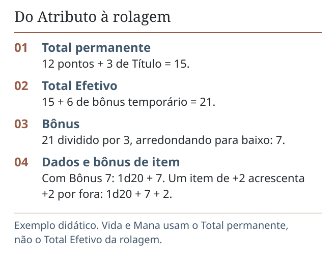

Cada Atributo tem três camadas, e é importante entender a diferença:

1. **Total** = seus pontos + bônus de Títulos + bônus de Espécie, Linhagem e Heranças. É a base **permanente**. Só ele entra na fórmula de Vida e Mana máximas.
2. **Total Efetivo** = Total + buffs e debuffs temporários de Skills + bônus condicionais contínuos. É o que vale para **rolar**.
3. **Bônus** = Total Efetivo ÷ 3, arredondado para baixo. Ele decide o **pool de d20**:
   - a cada 10 de Bônus você ganha **+1d20** (todos os dados são somados);
   - o que sobra (0 a 9) vira número fixo.

| Bônus | Rolagem |
|---|---|
| 0 a 9 | 1d20 + Bônus |
| 10 a 19 | 2d20 + (Bônus − 10) |
| 20 a 29 | 3d20 + (Bônus − 20) |
| 30 a 39 | 4d20 + (Bônus − 30) |

Exemplos: 12 pontos → Bônus 4 → **1d20+4**. 30 pontos → Bônus 10 → **2d20**. 75 pontos → Bônus 25 → **3d20+5**.

**Bônus de Item** (arma, armadura, modificação corporal, passivo de Skill) **nunca** entra nessa conta. Ele aparece como uma etiqueta verde **"+2 item"** ao lado da fórmula e é somado **por fora**, como número fixo, na hora da rolagem. Também não mexe na Vida nem na Mana.

### Vantagem e modificadores

Com Vantagem, o conjunto inteiro de dados é rolado duas vezes e vale o maior total; com Desvantagem, vale o menor. Modificadores de somar, subtrair, multiplicar e dividir são resolvidos na ordem combinada: somar 5 e depois multiplicar por 2 não é o mesmo que fazer essas operações ao contrário. Divisões arredondam para baixo.

No dano, os modificadores entram depois das escalas do atacante e antes das defesas do alvo. Eles não criam uma regra automática de crítico: se a cena justificar dano dobrado, esse multiplicador precisa ser decidido pela mesa.

### No Foundry — Distribuir pontos e rolar

#### Alocando Pontos de Atributo

O pool é: **35 pontos no nível 1 + 5 por nível acima do 1**, mais pontos extras que o Mestre possa ter dado só para você.

1. Clique **+** no Atributo desejado. O ponto fica **pendente** (destacado em dourado) e a ficha mostra a fórmula nova ao lado da atual: `1d20+2 → 1d20+3`.
2. **−** desfaz um ponto pendente.
3. Quando estiver satisfeito, clique **Confirmar**. Só então os pontos passam a valer (rolagem, Vida, Mana). Em modo criação não há Confirmar: quem confirma é a liberação do Mestre.
4. **Resetar** descarta todos os pendentes e volta ao último estado confirmado.

O **+** trava quando não há mais pontos livres.

Três ajudas na mesma lista:

- **Para que serve:** embaixo do nome de cada Atributo há uma frase com o que ele alimenta neste mundo, por exemplo "dano corpo a corpo · Vida" ou "iniciativa · deslocamento". Ela segue as fórmulas que o Mestre configurou.
- **Começar de um jeito:** enquanto nenhum ponto foi confirmado, os botões **Lutador**, **Conjurador**, **Ágil** e **Equilibrado** preenchem os pendentes com uma distribuição pronta. Não são classes: dá para mexer em tudo depois, ou clicar outro.
- **Ao confirmar:** com pontos pendentes, um painel mostra a Vida e a Mana de agora (riscadas) e as que você vai ter com esses pontos, com a conta ("Força 6 × Defesa 5 × 10"), mais a iniciativa e o deslocamento. É só uma prévia: nada muda antes de confirmar.

> **Pontos confirmados não voltam sozinhos.** Se você errou a distribuição, peça ao Mestre: ele tem o botão **Zerar pontos (Mestre)**, que devolve todos os pontos ao pool para você redistribuir do zero (nível, Títulos, Skills e Itens não mudam).

Se a sua mesa desligou o Pool de Pontos, os Atributos viram campos numéricos livres, sem orçamento nem confirmação.

#### Rolando

Clique no botão **d20** da linha do Atributo. O resultado vai para o chat com a fórmula completa (bônus de item incluso).

Se você tiver marcado um alvo no mapa (tecla **T** sobre um Token), bônus condicionais do tipo "+2 na rolagem contra Mortos-vivos" são levados em conta automaticamente.

#### Shift + clique: Vantagem e modificadores

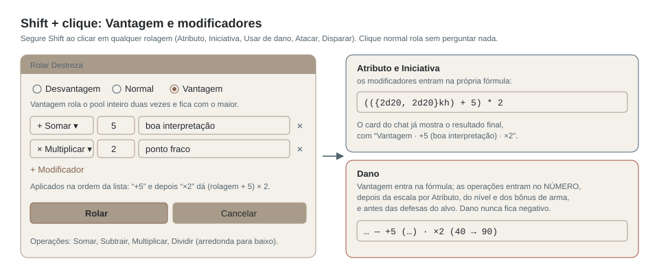

**Segure Shift ao clicar** em qualquer rolagem do sistema — Atributo, Iniciativa, **Usar** de uma Skill de dano, **Atacar** com arma, **Disparar** arma de nave. Abre uma janela com:

- **Desvantagem / Normal / Vantagem** — Vantagem rola o pool **inteiro** duas vezes e fica com o maior total; Desvantagem, com o menor.
- **Modificadores livres** — Somar, Subtrair, Multiplicar ou Dividir por um valor, com um motivo opcional ("boa interpretação", "ponto fraco"). Use **+ Modificador** para adicionar mais linhas.

As operações valem **na ordem da lista**: "+5" e depois "×2" dá (rolagem + 5) × 2. Divisão arredonda para baixo.

- Em Atributo e Iniciativa, tudo entra na fórmula e o chat mostra o resultado final.
- Em dano, a Vantagem entra na fórmula, e as operações são aplicadas ao número depois de todas as escalas automáticas e antes das defesas do alvo. Dano nunca fica negativo.

O sistema não tem regra de acerto crítico automática: se a cena pediu "dano dobrado", é você (ou o Mestre) quem escreve "×2" aqui.

---

## 4. Habilidades e poderes

### O que é uma Skill?

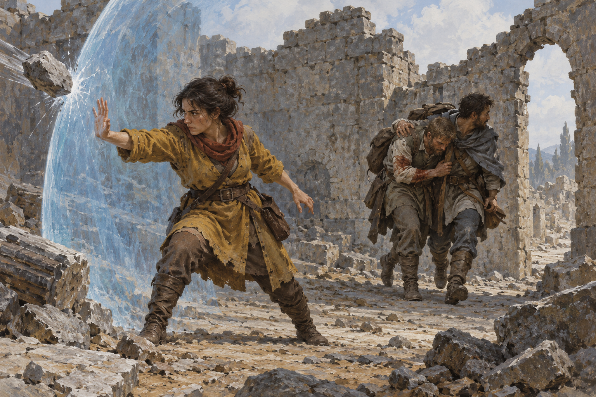

**Skill** é a palavra usada na ficha para **Habilidade**. Skills estão ligadas à alma de quem as possui e permitem realizar técnicas, acessar conhecimentos ou manifestar poderes. As Raciais estão ligadas à Espécie e ao corpo. Para jogar, comece pelo que a sua Habilidade permite fazer e pelas condições para usá-la.

Uma Skill pode conceder a memória muscular de uma arte marcial, permitir mover objetos com a mente, oferecer Resistência ou proteger um companheiro. Nem toda Habilidade é um ataque: algumas atuam de forma passiva, e outras são usadas em situações de exploração, conversa ou preparação.

### Atributo, Skill e nível

Um **Atributo** descreve uma capacidade geral, como Força ou Precisão. A **Skill** proporciona uma capacidade específica: muita Força não equivale à memória muscular de uma Skill de Karatê. Receber uma Extra também não dispensa o treino necessário para consolidar o conhecimento no cérebro e no corpo.

O **tier** identifica a categoria da Habilidade; o **nível** acompanha seu desenvolvimento dentro dessa categoria. Leia o efeito, os alvos, os custos e as condições da sua Skill para saber como ela funciona na mesa.

### Tiers

**Skill** é a palavra inglesa usada na ficha para **Habilidade**. **Tier** significa sua categoria ou patamar: Extra, Normal, Racial, Único ou Ultimate. Esse nome ajuda a identificar a categoria da Habilidade e como ela pode ser obtida.

**Tier e nível são coisas diferentes.** O tier é a categoria; o nível acompanha o aperfeiçoamento daquela Skill, com as regras de Poder, Custo ou Resistência descritas adiante. Uma Skill Normal de nível 10 continua sendo Normal: subir de nível não a transforma automaticamente em Único ou Ultimate.

O tier também não é a mesma coisa que a **mecânica ao usar**. Uma Habilidade pode causar Dano, aplicar Efeitos, erguer uma Estrutura ou ser Descritiva. Para saber o que ela realmente faz, leia seus efeitos, custos e condições de uso, além do tier.

#### Extra - Memória muscular, conhecimento e capacidades humanas

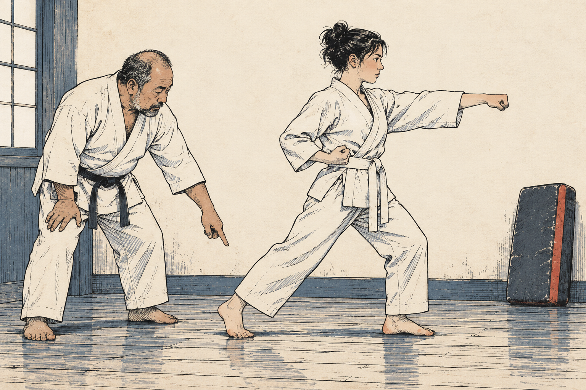

Skills Extras representam habilidades ou conhecimentos que seres humanos conseguem desenvolver na nossa realidade. A Skill concede a **memória muscular ou o conhecimento** sobre aquilo. Memória muscular é a familiaridade do corpo com a execução de uma técnica: saber como realizar os movimentos. Uma arte marcial como o Karatê é um exemplo.

Receber essa memória ou esse conhecimento não significa ter domínio completo. Ainda é preciso **treinar**, fixar o conhecimento no cérebro e no corpo e desenvolver a Skill.

> **Exemplo: Karatê Extra nível 1**
> A pessoa já estaria acima de um faixa branca do nosso mundo, exclusivamente por ter recebido a memória muscular da arte. Ela ainda precisa praticar para consolidar esse conhecimento e desenvolver sua execução. O nível 1 não a transforma automaticamente em mestre.

**Extra não significa sem importância ou sem domínio.** Um mestre de uma arte marcial do nosso mundo teria uma Skill Extra daquela arte. O nome do tier descreve a natureza da habilidade; seu nível representa seu desenvolvimento. Dominar uma técnica humana de maneira excepcional não a torna sobrenatural por si só.

#### Normal - A entrada no sobrenatural

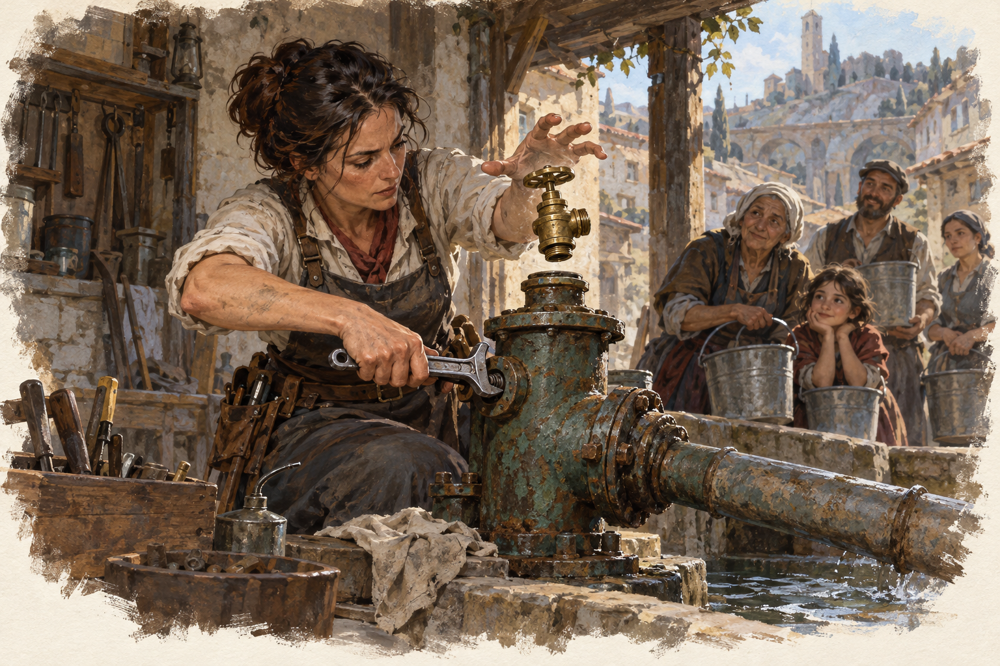

Skills Normais têm efeitos que ultrapassam o que uma pessoa consegue realizar na nossa realidade. **Sobrenatural** significa justamente isso: algo que vai além das capacidades humanas reais, como mover um objeto com a mente ou produzir uma bola de fogo.

Uma Skill Normal pode ter **dois começos**:

- **Evoluir de uma Extra:** uma técnica que antes era humana ganha um efeito sobrenatural. Por exemplo, uma técnica de Karatê poderia evoluir e passar a projetar uma onda de energia. Combine o efeito com o Mestre.
- **Surgir diretamente como sobrenatural:** Telecinese, que move coisas com a mente, ou Bola de Fogo podem começar como Skills Normais, sem uma Extra anterior.

Ganhar níveis numa Extra e **evoluí-la para Normal** são acontecimentos diferentes. No primeiro, a capacidade se desenvolve; no segundo, ela passa a ter uma natureza sobrenatural. A mudança de tier é resolvida como evolução, separadamente dos níveis.

#### Racial - Um poder da Espécie

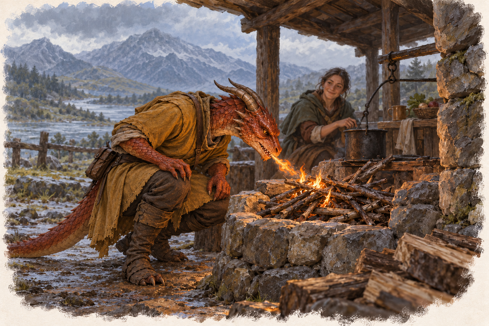

Uma Skill Racial é um poder que aquela **Espécie consegue usar**. O termo Racial é o nome da categoria na ficha; aqui ele se refere à Espécie do personagem.

Um sopro dracônico é um exemplo de poder ligado a uma Espécie. A definição concreta depende do catálogo da campanha. O que identifica a Skill como Racial é seu vínculo com a Espécie, e não simplesmente ser uma técnica aprendida ou um poder personalizado para um indivíduo. No sistema, Skills Raciais vêm da origem e não são compradas com Pontos de Habilidade.

#### Único - Um poder que expressa a pessoa

Skills Únicas são **bem mais fortes que Skills Normais** e são feitas exclusivamente para a pessoa que as possui. Nascem da sua **personalidade, emoções e vontade**. Não basta escolher um nome raro: o poder deve expressar quem aquela pessoa é e o que deseja.

Uma Única pode ter efeitos variados e, às vezes, mais de um efeito. Para imaginar a sua, pense no que o personagem mais valoriza, teme, deseja ou se recusa a abandonar. Essas respostas ajudam a construir o poder com o Mestre; elas não determinam uma fórmula obrigatória.

O tier aparece como **Único** na ficha. Ao falar de uma habilidade, usamos também **Skill Única**.

#### Ultimate - Controle sobre aspectos da realidade

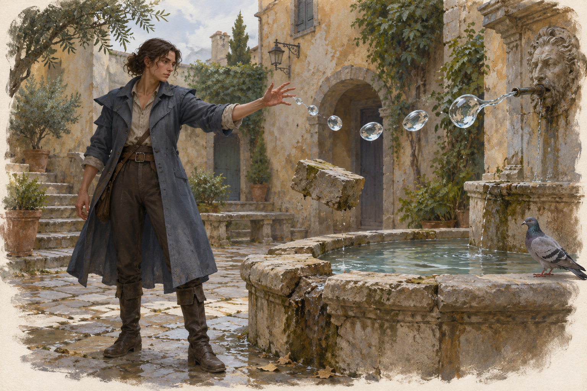

Skills Ultimate são o **ápice do sobrenatural**: permitem que alguém controle aspectos da própria realidade. Cada Ultimate possui uma identidade ligada ao aspecto da realidade que controla.

A obtenção e os efeitos de uma Ultimate são combinados com o Mestre conforme a campanha.

#### Referência rápida dos tiers

| Tier | O que representa |
|---|---|
| **Extra** | Concede memória muscular ou conhecimento de uma capacidade humana real. O domínio se desenvolve com treino e níveis. |
| **Normal** | Poder sobrenatural; pode nascer diretamente assim ou de uma Extra que ganha um efeito sobrenatural. |
| **Racial** | Poder que a Espécie consegue usar. |
| **Único** | Poder exclusivo de uma pessoa, baseado em sua personalidade, emoções e vontade; pode ter vários efeitos. |
| **Ultimate** | Ápice do sobrenatural: controle sobre aspectos da realidade. |

#### Obter uma Habilidade

Você pode pedir Habilidades com os Pontos de Habilidade disponíveis e combinar aquisições com o Mestre. As Raciais vêm da origem do personagem; algumas outras Habilidades são concedidas por equipamentos ou transformações. Os procedimentos para fazer pedidos estão em **Aprender e desenvolver Skills**.

### Tipos de Alvo

O alvo define em quem ou onde o efeito acontece. Alcance, área e duração são características concretas do poder, combinadas com o Mestre.

| Tipo | Como funciona |
|---|---|
| **Targetada** | Afeta um alvo escolhido, incluindo o próprio usuário quando permitido. |
| **Si mesmo** | Afeta quem usa a Skill. |
| **Emissão** | Aplica o efeito imediatamente numa área em Círculo, Cone ou Linha. |
| **Zona** | A área permanece por um prazo. Em combate, quem estiver dentro no início do próprio turno sofre o efeito; sair antes pode evitá-lo. |

Uma Emissão rola o dano uma vez, e cada alvo recebe a aplicação das próprias defesas sobre esse total. Uma Zona volta a resolver seu efeito a cada turno pertinente e não aplica ticks automaticamente fora de combate.

### Mecânicas de uma Skill

A mecânica descreve o que uma Skill produz quando é usada. Ela pode funcionar de uma destas maneiras:

- **Descritiva** — usar não rola nem aplica nada, só avisa no chat. Pode ter passivos.
- **Dano** — rola a **Fórmula de Dano** (qualquer fórmula de dados do Foundry, ex.: `2d6+3`). Pode ter:
  - **Atributo de Escala** — multiplica o dano por (Atributo.Total)² ÷ 10. Com Magia 20: ×40. É o que faz o dano acompanhar o crescimento da Vida ao longo da campanha.
  - **Dano Mágico** — ativa a redução por Defesa Mágica do alvo.
  - **Dano Absoluto** — não pode ser resistido (veja [Combate](#dano-absoluto)).
  - **Elemento(s)** — Fogo, Gelo, Físico, Phaser… O dano é dividido entre eles.
- **Efeito Temporário** — uma lista de **Efeitos**, cada um com Alvo, Quantidade e Duração:
  - um Atributo (buff se positivo, debuff se negativo);
  - **Curar Vida (na hora)** e **Restaurar Mana (na hora)** recuperam os valores atuais; a quantidade pode ser fixa ou um percentual do máximo;
  - **HP** ou **Mana**, sem Periódico, alteram temporariamente o máximo, e não curam; com **Periódico**, aplicam ticks (ex.: Veneno −10 por rodada por 3 rodadas; Regeneração +5);
  - **Escudo** (soma direto, sem duração);
  - **Deslocamento (%)**;
  - aprimoramento das suas **armas equipadas** (mais dano, trocar o elemento, tornar o dano Mágico ou Absoluto);
  - sistemas de **Nave** (para Skills usadas por naves ou por tripulantes nelas).
  Cada Efeito pode ter uma **Condição** (Cegueira, Veneno…), que põe o ícone no Token.
- **Estrutura** — ergue uma parede, bloco ou barreira no mapa (veja [Estruturas](#estruturas)).

### Custo e Habilidades Ativas

- **Custo** é pago uma vez, ao usar.
- Uma **Habilidade Ativa** é um liga/desliga: o Custo é pago ao **ligar**, e o **Custo por Rodada** é drenado no **início de cada turno seu** em combate, enquanto ela estiver ligada.
- Buffs de uma Skill Ativa duram **até você desligá-la**. Religá-la não "renova" nem acumula o que já está ativo.
- **Mana variável:** uma Skill marcada **"Aceita variar a Mana"** pergunta, ao usar, quanta Mana investir. Menos que o Custo enfraquece na mesma proporção (metade da Mana, metade da força). Mais que o Custo fortalece **sem teto**, mas cada Mana a mais rende menos que a anterior: com o padrão, 10× o Custo dá ×5,6 de força, e 40× dá ×15,9 — o golpe gigante é possível, mas gasta muito por pouco. A força vale para o dano, os valores dos Efeitos (buff, Escudo, veneno) e a Vida de uma Estrutura. Numa Habilidade Ativa, o Custo por Rodada acompanha o que você investiu ao ligar.
- **Mana em 0 desliga todas as suas Habilidades Ativas de uma vez.** Os efeitos que elas sustentavam somem no início do seu próximo turno (ou na hora, fora de combate).

### Sub-Skills

Uma Skill fundida guarda dentro dela as Skills que a formaram, como componentes utilizáveis (no estilo das Skills Únicas de *Tensura*). Em cada uso, você escolhe qual componente ativar. Cada componente tem sua própria mecânica, custo e nível, e pode ficar ligado independentemente dos outros.

### Nível de uma Skill

Subir de nível aperfeiçoa uma Skill dentro de sua categoria. A evolução pode transformá-la e acrescentar novas funções; o Mestre apresenta o resultado quando isso acontece na história.

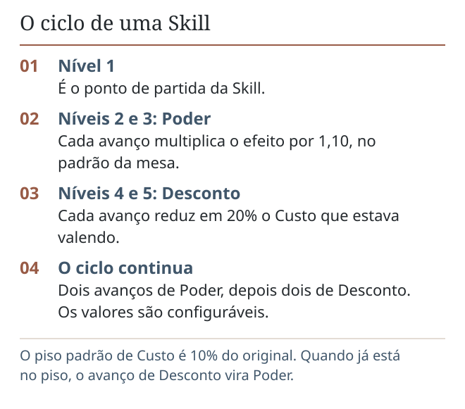

Cada nível segue um ciclo fixo e previsível: **2 níveis de Poder** (+10% no efeito cada) e depois **2 níveis de Desconto** (−20% no Custo cada), repetindo. Tudo é multiplicativo:

- Poder multiplica o dano e as quantidades dos Efeitos;
- o Custo nunca cai abaixo de 10% do original, e uma Skill que custa alguma coisa custa no mínimo 1;
- quando um nível de Desconto chegaria com o Custo já no piso, ele vira um nível de Poder — nenhum nível é desperdiçado.

O Custo escrito na Skill é sempre o do nível 1; o desconto é aplicado na hora de usar.

Uma Skill pode subir de nível pela progressão de XP, com confirmação do Mestre, ou pelo gasto de um Ponto de Habilidade do mesmo tier, quando essa opção estiver disponível. O gasto de Ponto não depende de completar a barra de XP. Skills concedidas por Item não sobem de nível.

### Skills de Resistência

Uma Skill pode oferecer uma **Resistência**: **Geral** (reduz qualquer dano) ou a um **elemento** (reduz só aquele tipo — "Físico" cobre cortes e pancadas).

- 10% por nível.
- **Geral** para no nível 5 (50%). Não existe "Imunidade Geral".
- **Elemental** chega a 100% no nível 10 e passa a se chamar **"Imunidade: Fogo"**.
- Vale **enquanto a Skill estiver na ficha** — não precisa usar.
- Ganha **XP sozinha** quando de fato bloqueia dano, proporcional à fatia da sua Vida que ela salvou (bloquear 10% da sua Vida rende 10 XP; um arranhão rende 0).

### Outros passivos de uma Skill

Entre os efeitos passivos estão:

- **Modificador permanente** de HP Máximo e Mana Máxima;
- **Bônus de atributo** — soma fixa na rolagem (como bônus de item), nunca na Vida/Mana;
- **Bônus condicionais** — regras "Quando → Então" (veja [Bônus condicionais](#bônus-condicionais)).

Na prática, Resistência, modificadores de HP/Mana e bônus de atributo valem **sempre que a Skill estiver na ficha**, mesmo numa Habilidade Ativa desligada. Só os **bônus condicionais** de uma Habilidade Ativa respeitam o liga/desliga (valem enquanto ela estiver ligada).

### Skills concedidas

Itens equipados, Módulos de nave e modificações corporais podem **conceder** uma Skill. Ela aparece com ⚙ na lista e:

- é fixa: não ganha XP, não sobe de nível, não entra em Fusão nem Evolução;
- some quando a fonte sai (desequipou, removeu a prótese, desligou o Módulo);
- qualquer mudança feita nela é perdida quando ela é concedida de novo — quem manda é a fonte.

### No Foundry — Usar e acompanhar Skills

#### A lista de Habilidades na ficha

Cada Skill aparece com o nome e, embaixo dele, **a Skill numa frase**: o que ela faz · onde · quanto custa · quanto custa por rodada. Exemplo: *"3d6 de Fogo · cone de 6 m · 20 Mana · Ativa: −3/rodada"*. O Custo já vem com o desconto do nível; uma Resistência mostra o seu %; uma Skill com Sub-Skills mostra quantas tem. Ao lado, um botão:

| Botão | Significa |
|---|---|
| **Usar** (dado) | Skill de Dano. |
| **Usar** (brilho) | Efeito Temporário ou Descritiva. |
| **Usar** (quebra-cabeça) | A Skill tem Sub-Skills: você vai escolher qual usar. |
| **Desativar** | Habilidade Ativa que está ligada agora. Clicar desliga. |
| ⚙ no começo da linha | Skill **concedida** por um Item, Módulo ou modificação. É fixa. |

#### Skills e armas na hotbar

Toda linha com **Usar**, **Atacar** ou **Disparar** pode ser **arrastada para a hotbar** (a barra de macros embaixo da tela). Clicar no atalho faz exatamente o que o botão da ficha faz, sem abrir a ficha; **Shift** + clique abre os modificadores de rolagem, como na ficha. Consumíveis também vão para a hotbar.

Arrastar para a hotbar não copia a Skill para lugar nenhum: o atalho só aponta para ela. Se não funcionar, o Mestre pode ter tirado dos jogadores a permissão de criar macros.

#### O que acontece ao clicar em Usar

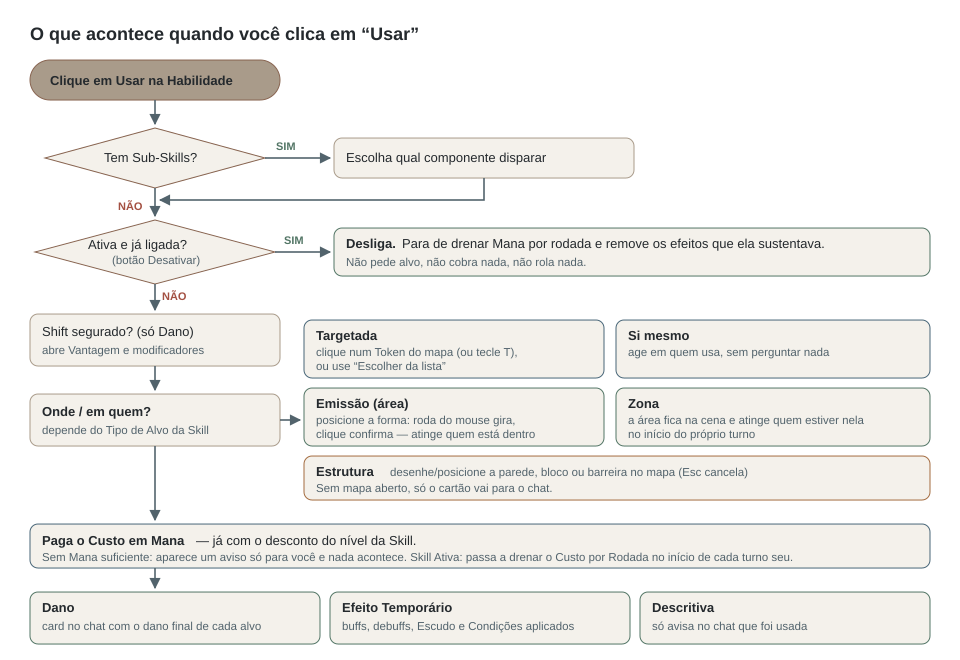

Em ordem:

1. **Sub-Skills?** Se a Skill for uma fusão (várias habilidades dentro de uma), você escolhe qual componente disparar.
2. **Ativa e já ligada?** Então o clique só desliga: para o dreno de Mana e remove os efeitos que ela sustentava. Não pede alvo nem cobra nada.
3. **Shift?** Numa Skill de Dano, o Shift abre Vantagem/modificadores.
4. **Onde ou em quem** — depende do **Tipo de Alvo** da Skill (veja abaixo).
5. **Custo** — a Mana é descontada. Se não houver Mana suficiente, aparece um aviso só para você e nada acontece.
6. **Resultado** — rolagem de dano no chat, efeitos aplicados, estrutura erguida, ou só um aviso de uso.

Se algo der errado no meio do caminho, aparece um **aviso vermelho** no topo da tela dizendo o que falhou — avise o Mestre. Caído ou Inconsciente, o clique é recusado com um aviso (desligar uma Habilidade Ativa continua possível).

**Errou o clique?** O Mestre tem **Desfazer uso** no card da Skill até o fim do seu turno: a Mana volta, os efeitos saem e o dano já aplicado volta junto. Só o Mestre vê o botão; o card fica riscado para todos.

**A Skill pode se desenvolver com o uso.** O Mestre acompanha sua progressão e confirma os avanços. Armas não ganham XP como Skills.

#### Selecionar alvos no aplicativo

| Tipo | Como escolher |
|---|---|
| **Targetada** | Um alvo. Se você já marcou um Token com **T**, ele é usado direto. Senão aparece uma faixa no topo: *"clique no alvo no mapa"* — clique num Token. **Escolher da lista** abre uma lista agrupada (**Na cena**, **Meus personagens**, **Personagens**), em que você mesmo aparece como "(você mesmo)". **Cancelar** desiste. |
| **Si mesmo** | Age em quem usa. Não pergunta nada. |
| **Emissão** | Uma forma (**Círculo**, **Cone** ou **Linha**) segue o mouse. A **roda do mouse gira** Cone e Linha. **Clique esquerdo** confirma, **clique direito** ou **Esc** cancela. Atinge na hora todos os Tokens dentro da forma. |
| **Zona** | Igual à Emissão para posicionar, mas a área **fica na cena** por algumas rodadas de combate. Quem estiver dentro dela **no início do próprio turno** sofre o efeito (dano rolado de novo a cada vez). Sair da área antes do seu turno escapa. Fora de combate a Zona não faz nada. |

Numa Emissão, o dano é rolado **uma vez** e cada alvo aplica as próprias defesas a esse mesmo total; o chat mostra uma linha por alvo.

Se a mesa não usa mapa (teatro da mente), a lista de alvos pode alcançar Atores sem Token — depende de uma regra que o Mestre liga.

#### Alterar o nível na ficha

Uma Skill sobe de nível de dois jeitos:

- o Mestre clica **+ Nível** (normalmente quando o XP da Skill enche);
- você clica **Subir nível (1 Ponto)** na ficha da Skill, gastando 1 Ponto de Habilidade do mesmo tier dela (Extra, Normal ou Único). Não depende do XP.

Skills concedidas por item não sobem de nível.

#### Avisos do editor e sugestão de custo

**Avisos e custo sugerido.** Se a mesa usa o editor de Skill assistido (vem ligado), a ficha da Skill e o editor de pedido avisam o que não vai funcionar como parece: Periódico num alvo que não é Vida ou Mana, Custo por rodada numa Skill que não é Ativa, área de tamanho 0, fórmula de dano inválida, um Efeito sem valor e sem Condição, um custo maior que a sua Mana máxima… Os avisos em vermelho são o que não faz nada; os amarelos são "confira". Nenhum aviso impede de salvar.

Ao lado do Custo aparece um **sugerido N**, calculado pelo que a Skill faz (dano médio, área, duração, Condições). Verde quer dizer que o seu Custo está a até 30% da sugestão; **usar** troca pelo sugerido, e clicar no selo mostra a conta. É uma sugestão para conversar com o Mestre, não uma regra: a sua Mana máxima não muda o número, só aparece embaixo ("50% da sua Mana · usa 2×").

---

## 5. Aprender e desenvolver Skills

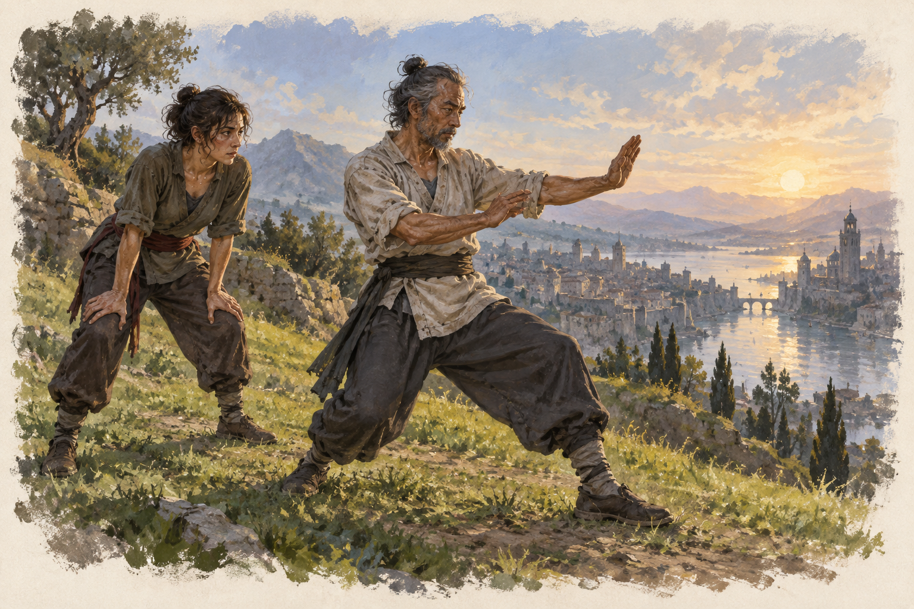

Pontos de Habilidade representam oportunidades de adquirir ou desenvolver Skills. Eles têm três categorias: **Extra, Normal e Único**. Com os padrões de criação, você começa com 3 Normais e recebe mais 2 por nível acima do primeiro.

### Conversão e desenvolvimento

Três Pontos Extra podem ser reunidos em um Normal, e três Normais em um Único. A troca também funciona no sentido inverso: um Ponto se divide em três do tier imediatamente abaixo. Racial e Ultimate não participam dessa economia de Pontos.

Você pode propor uma Skill nova e combinar com o Mestre seu conceito, efeitos e custo. A proposta só se torna uma concessão depois de aprovada. Também é possível gastar um Ponto do tier correspondente para subir o nível de uma Skill elegível, independentemente da barra de XP.

### Do treino ao sobrenatural

Desenvolver uma Extra aprofunda uma técnica ou conhecimento. Transformá-la em Normal é outro acontecimento: ela ganha um efeito sobrenatural. Uma Normal também pode começar diretamente como um poder sobrenatural. Os níveis, sozinhos, não mudam o tier automaticamente.

### No Foundry — Pontos, conversões e pedidos

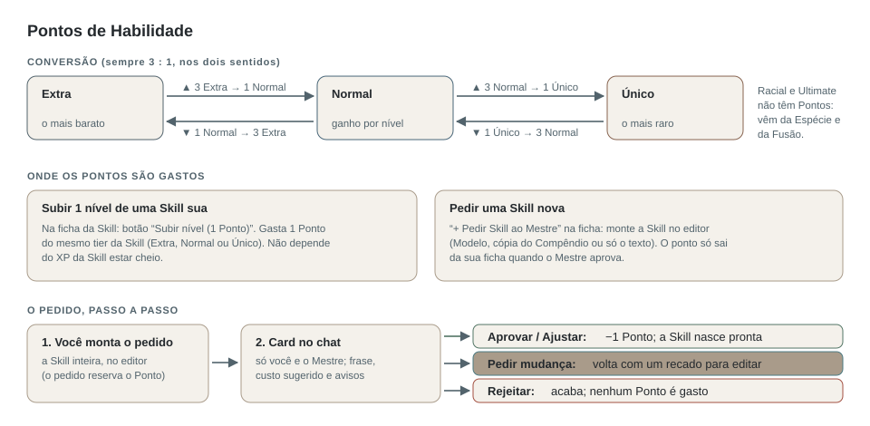

Existem três tipos: **Extra**, **Normal** e **Único**. Você começa com **3 Normais** e ganha **+2 Normais por nível**.

#### Converter

- **▼** (quebrar): 1 ponto vira **3** do tier abaixo (1 Normal → 3 Extra; 1 Único → 3 Normal).
- **▲** (juntar): **3** pontos viram 1 do tier acima (3 Extra → 1 Normal; 3 Normal → 1 Único).

#### Gastar

1. **Pedir uma Skill nova** — veja abaixo.
2. **Subir o nível de uma Skill** — veja [Nível de uma Skill](#nível-de-uma-skill).

#### Pedir uma Skill ao Mestre

Você monta a Skill inteira, e a aprovação a cria pronta para usar.

1. Clique **+ Pedir Skill ao Mestre**. O botão diz quantos pontos ainda estão livres: um pedido aberto já reserva o ponto dele, então dois pedidos nunca disputam o mesmo ponto.
2. Abre o editor de Skill, o mesmo que o Mestre usa. Em **Começar de**, escolha:
   - um **Modelo** (Golpe, Área de dano, Cura, Escudo, Zona…), que vem preenchido;
   - **Do Compêndio…**, para começar de uma cópia de uma Skill que já existe no mundo;
   - **Só descrever**, para mandar só o texto e deixar a mecânica com o Mestre (como era antes).
3. Ajuste o nome, o **Tier** (só os que têm ponto livre aparecem), a mecânica e o Custo. O [custo sugerido e os avisos](#mecânicas-de-uma-skill) ajudam a não pedir algo quebrado. O Nível é sempre 1.
4. **Enviar pedido**. Um card vai para o chat, visível só para você e para o Mestre, e a Skill aparece na sua lista de Habilidades **tracejada**, com **aguardando**. O ponto ainda não saiu.

O Mestre responde pelo card:

| Botão do Mestre | O que acontece com você |
|---|---|
| **Aprovar** | O ponto é descontado e a Skill nasce na ficha, no nível 1, com a mecânica que você pediu. A Voz do Mundo avisa. |
| **Ajustar e aprovar…** | O Mestre muda o que achar preciso (custo, área, nome…) e aprova a versão dele. |
| **Pedir mudança…** | O pedido volta com um recado. A linha da sua lista vira **ajustar** com o recado, e um aviso aparece na tela. Clique **editar** na linha (ou **Editar pedido** no card), mude e envie de novo. |
| **Rejeitar** | O pedido acaba e nenhum ponto é gasto. |

Enquanto o pedido está aberto, **editar** na linha da lista reabre o editor e manda a versão nova para o mesmo card. Clicar no nome da Skill no card abre a Skill completa, só para ler.

---

## 6. Equipamento e recursos

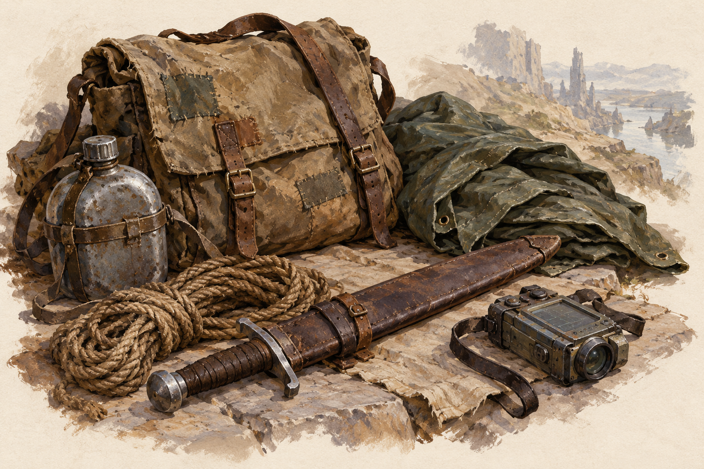

Equipamento oferece meios de agir: uma arma muda o golpe disponível, um recipiente organiza a carga, um consumível resolve uma necessidade imediata. O que você recebe, compra ou encontra pertence à campanha. Combine esses recursos com o Mestre.

### Armas, suprimentos e carga

Uma arma equipada usa sua própria fórmula de dano e pode ter elementos, marca Mágica, Dano Absoluto e Atributo de Escala. Ela não tem nível de Skill, não custa Mana e não ganha XP de uso. Aprimoramentos de arma podem alterar os ataques enquanto durarem.

Uma arma com carregador gasta um disparo por ataque. Recarregar usa uma unidade de munição compatível. Trocar a munição devolve o que restava ao inventário; uma unidade parcialmente usada conserva os disparos que sobraram. Fórmula, elementos e Dano Absoluto da munição podem substituir os da arma.

Consumíveis, como poções e kits, podem causar dano, curar, modificar valores ou aplicar Condições. Não precisam estar equipados, não custam Mana e não ganham XP. Cada uso consome uma unidade ou uma carga; um personagem incapacitado não usa o item por conta própria, mas um aliado pode usá-lo nele.

Se a mesa usa Inventário, pilhas e contêineres ocupam slots. Carga depende da Espécie, da Força e da Defesa; ultrapassá-la apenas avisa, a menos que a opção de penalidade por peso esteja ligada. O exemplo de 25 poções com limite de 20 por pilha ocupa dois slots.

### Moedas e trocas

Doran separa o dinheiro para suprimentos enquanto Lia negocia a passagem. Registre o que cada um carrega e o que foi transferido a outra pessoa.

As moedas são definidas pela campanha. O padrão usa Ouro, Prata e Cobre: 1 Ouro vale 10 Prata ou 100 Cobre. Conversões preservam o restante em moedas de menor valor. Recursos disponíveis e preço não são concedidos automaticamente por este manual.

### No Foundry — Itens, inventário e moedas

#### Inventário

Com o bloco **Inventário** ligado, a ficha ganha a aba **Inventário** (a aba Ficha passa a mostrar só os itens **equipados** — é dali que as armas atacam).

- **Slots:** cada pilha ocupa 1 slot. Um item empilha até o valor de **Empilha até** (padrão 20): 25 poções ocupam 2 slots. Os slots vêm da sua **Espécie** (Humano 10, Anão 12, Goblin 8…), e o Mestre pode dar extras.
- **Pilhas:** arrastar para a ficha um item igual (mesmo nome e imagem) **soma na pilha**. O botão de dividir (⑂) separa uma pilha em duas.
- **Contêineres** (mochila, bolsa, cinto): ocupam sempre **1 slot** e têm slots próprios; o que está dentro pesa menos pela redução do contêiner. Para guardar, use o seletor **Guardar em** na linha do item, ou arraste o item até o quadro do contêiner. Uma Skill também pode dar um contêiner (bolsa dimensional, estômago do Slime), às vezes ilimitado.
- **Peso:** a barra de Peso compara o que você carrega (itens + moedas) com a sua **carga** = base da Espécie + Força × 1 kg + Defesa × 0,5 kg (números do Mestre). Passar da carga só avisa, a menos que a mesa use **Peso limita o Deslocamento**: aí você perde Deslocamento na proporção do excesso (20% acima = −20%; o dobro = parado).
- **Equipar** direto na linha (ícone de roupa), sem abrir o item.
- **Mover** entre fichas: arrastar um item da ficha de um personagem seu (ou do Porão de uma Nave da tripulação) para outra **move** o item; do Diretório ou Compêndio, **copia**.
- Busca, filtro (Equipados, Armas, Contêineres, Munição) e ordem (Nome, Peso, Quantidade) no topo; equipados sempre primeiro.

A ficha de um Item Geral tem as abas **Geral**, **Arma**, **Consumível** e **Enquanto equipado** (além de **Descrição**, e **Implante** quando a mesa usa Anatomia).

- **Geral**: Quantidade, Peso, Valor (com a moeda) e o interruptor **Equipado**.
- **Arma**: liga **"Este item é uma arma"** e define **Fórmula de Dano**, **Atributo de Escala**, **Dano Mágico**, **Dano Absoluto**, **Escala do golpe** e **Elemento(s)** — os mesmos campos de uma Skill de Dano.
- **Enquanto equipado**: a **Habilidade Concedida**, **Modificador permanente** de HP/Mana, **Bônus de atributo** e **Bônus condicionais**.

**Tudo depende de Equipado.** Ligado: a Skill é concedida, os bônus valem e, se for arma, aparece **Atacar** na sua ficha. Desligado: a Skill some, os bônus param de contar, e a arma mostra "(desequipada)".

#### Atacar com uma arma

Clique **Atacar** (Shift para modificadores), escolha o alvo como numa Skill Targetada, e o dano segue exatamente o mesmo caminho de uma Skill de Dano. Diferenças: arma não tem nível, não custa Mana e só ataca um alvo (arma de área é uma Skill).

Skills de **aprimoramento de arma** (Efeito Temporário com alvo "Dano das Armas equipadas", "Elemento das Armas", "Armas causam dano Mágico", "Armas causam Dano Absoluto") valem para **todas as armas equipadas** enquanto durarem.

#### Carregador e munição

Uma arma pode ter **carregador** (**Disparos por carga** na aba Arma; 0 = sem carregador, ataca sem limite). Com carregador:

- a linha da arma mostra **🔋 disparos/máximo**; cada **Atacar** gasta 1;
- vazio, a arma não ataca (o aviso aparece antes de pedir alvo);
- **⟳ Recarregar** gasta 1 **munição** compatível do seu inventário (um Item marcado como munição, de um tipo que a arma aceita). Se só houver uma munição que serve, recarrega direto; senão, abre uma janela para escolher (ou **só descarregar**);
- o ⟳ também serve para **trocar de munição**: o que estava dentro **volta para o inventário** — cheio volta para a pilha, pela metade volta como uma unidade "aberta" com os disparos que sobraram;
- a munição pode mudar o golpe: fórmula, elementos e Dano Absoluto dela substituem os da arma até a próxima recarga, e algumas têm **Carga** própria (Célula grande = 20 disparos, pequena = 10).

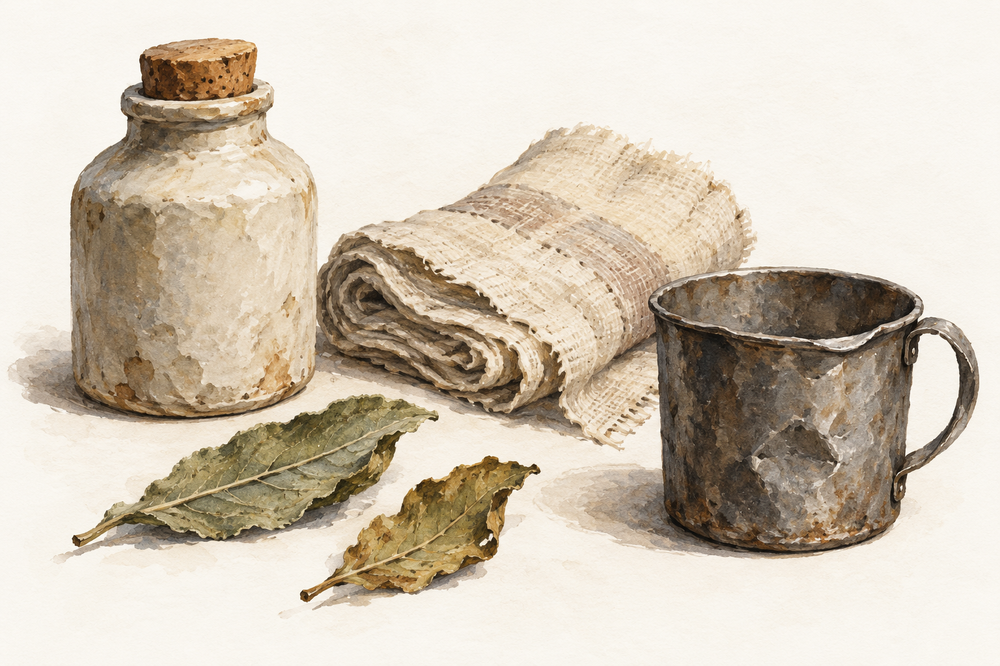

#### Consumíveis

Poção, granada, kit médico, estimulante: um Item com a aba **Consumível** ligada ganha o botão **Usar** na linha do inventário — **não precisa estar equipado**.

- Pode ser **Efeito** (cura, buff, Condição) ou **Dano**, e agir **em si**, **num alvo** ou numa **área** (uma granada se posiciona como uma Emissão).
- Cada uso gasta **1 da pilha**; com **Cargas por unidade** (kit de 5 usos), gasta 1 carga e só tira 1 da pilha quando as cargas acabam. A última unidade some da ficha.
- Cancelar a escolha de alvo ou de área **não gasta nada**. Uma granada lançada onde não havia ninguém é gasta.
- O dano de um consumível escala por Atributo como uma Skill, e os efeitos podem ser em **% do máximo** ("Curar Vida 25% do máximo"). Não custa Mana e não ganha XP.
- **Caído?** Você não usa nada, mas um aliado pode usar uma poção **em você**.

Só o Mestre cria Itens na sua ficha (botão **+ Novo Item**). Você pode receber itens arrastados de compêndios ou de outras fichas.

#### Economia na ficha

O bloco **Economia** mostra cada moeda (padrão: Ouro, Prata e Cobre — 1 Ouro = 10 Prata = 100 Cobre), o peso de cada pilha e o **peso total em moedas**. O peso é só informativo: não há limite de carga.

Os valores só são editáveis pelo Mestre. Você usa dois botões:

- **Converter** — troca uma quantidade de uma moeda por outra. Se a conversão não der número inteiro, o **resto cai na moeda de valor menor**, e nada se perde.
- **Enviar Dinheiro** — transfere para outro Personagem **que esteja na cena atual**.

---

## 7. Vida, energia e recuperação

Vida representa quanto o personagem ainda consegue suportar; Mana é a energia disponível para seus poderes. Escudo é uma proteção adicional, concedida por efeitos específicos. Entender essas três reservas ajuda a decidir quando insistir, recuar, sustentar uma Skill ou procurar recuperação.

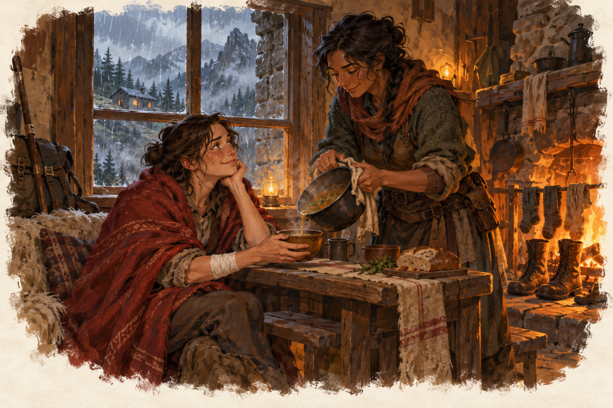

### Vida máxima e Mana máxima

Com os ajustes de fábrica:

- **Vida máxima** = Força.Total × Defesa.Total × 10 (nunca menos que 50);
- **Mana máxima** = Magia.Total × Defesa Mágica.Total × 10 (nunca menos que 50).

Depois disso somam-se, sem limite, os modificadores permanentes de Títulos, Skills, Itens equipados e modificações corporais ("+50 de HP Máximo"), e buffs temporários de Vida/Mana.

Exemplo: Força 8 e Defesa 6 → 8 × 6 × 10 = **480** de Vida.

Repare que só o **Total** (pontos + Títulos + bônus de origem) entra aqui. Um buff de +10 de Força de uma Skill melhora a sua rolagem, mas **não** aumenta a sua Vida máxima.

> O Mestre pode trocar quais Atributos entram em cada fórmula, o multiplicador e o piso. Numa campanha sem magia ele pode até desligar a Mana: a barra some e as Skills passam a não custar nada.

O nome "Mana" também é configurável (Ki, Fluxo Quântico…). Este manual usa "Mana".

### Escudo pessoal

O **Escudo** é Vida extra temporária concedida por Skills (ex.: "Barreira Arcana dá 30 de Escudo"). Não tem máximo nem duração: fica até ser gasto.

Quando você leva dano, o **Escudo absorve primeiro** e só o que sobra sai da Vida. Exceção: **Dano Absoluto** ignora o Escudo. Alguns elementos (como Táquion, em campanhas sci-fi) causam **dano extra só no Escudo**, e outros são fracos contra ele (um torpedo tira menos do Escudo).

**Vários escudos:** cada Skill que te dá Escudo cria o seu **pool**, com Vida própria. A ficha mostra o total e, embaixo, cada pool ("Barreira 30 · Muralha 20"). Ao levar dano, **o escudo mais recente apanha primeiro**, até zerar, e só então o anterior. Escudo digitado à mão fica por último. A **Penetração** do golpe age em **cada** escudo, um depois do outro: cada camada deixa passar a parte penetrada, que encontra a próxima camada e é dividida de novo; o que chega com menos de 1 de dano é descartado.

Um Escudo pode acender uma **luz** no seu Token (um campo de energia brilhando). Ela é apagada sozinha quando o Escudo chega a 0 ou quando a Skill que o criou é desligada.

**Escudo mantido** (ex.: *Barreiras Múltiplas*): numa Habilidade Ativa, o Escudo pode ter **Regeneração por rodada** e **Teto**. Ao ligar, entra o valor inicial até o teto; no início de cada turno seu (enquanto ela estiver ligada e você pagar o custo por rodada) ele regenera até o teto; ao desligar — ou se a Mana acabar — as camadas somem (o pool daquela Skill sai inteiro; os escudos de outras Skills ficam). O teto vale para o pool da própria Skill. Fora de combate, o Mestre pode aplicar a regeneração entre cenas quando isso fizer sentido na situação.

### Recuperação e descanso

Depois da travessia, o grupo encontra abrigo. Ícaro verifica a segurança do lugar, Doran prepara comida e os demais cuidam dos ferimentos. O Mestre informa se a pausa permite um descanso curto ou completo.

- Um **Descanso Curto** devolve parte das reservas: no padrão, 25% da Vida e 50% da Mana. Um **Descanso Completo** recupera as duas, respeitados os bloqueios e limites das partes do corpo.
- Skills de cura, consumíveis (poções, kits) e Condições como **Regeneração**.
- Se a mesa ligou a **regeneração natural**, um pouco da Mana volta sozinha no início de cada turno seu em combate.

### Vida 0: Caído e Inconsciente

Se a mesa usa esta regra (vem ligada), chegar a **0 de Vida** não é o fim na hora:

- **Personagem de jogador** fica **Caído**, com um **contador de morte** (padrão: 3 rodadas, contadas no início do seu turno). O número aparece em vermelho sobre o ícone no seu Token. Quando o contador zera, o Mestre é **avisado** — o sistema nunca mata ninguém sozinho; quem decide é ele.
- Um aliado pode buscar **estabilizar** você, com a confirmação do Mestre: o contador para, mas você continua caído.
- Qualquer coisa que tire a sua Vida do 0 (cura, poção, regeneração) troca **Caído** por **Inconsciente**: você ainda perde alguns turnos (padrão 3) e acorda depois. Um **Descanso** acorda de vez.
- **NPCs** (e personagens sem jogador dono) morrem direto em 0, a menos que o Mestre tenha desligado isso.

**Caído ou Inconsciente, você não age:** não usa Habilidades, não ataca, não usa consumíveis, não corre e o Token não se move. Ao cair, **todas as suas Habilidades Ativas desligam**.

**O que continua funcionando:** o que o corpo faz sozinho — Regeneração (da Espécie, de Título, de Skill), curas periódicas e curas que os outros usam em você. Um aliado pode usar uma poção **em você**. A **Mana não regenera** enquanto você estiver incapacitado; só a Vida.

> **No Foundry:** consulte os controles de descanso e das barras em [A ficha no Foundry](#apêndice-a-a-ficha-no-foundry).

---

## 8. Combate e consequências

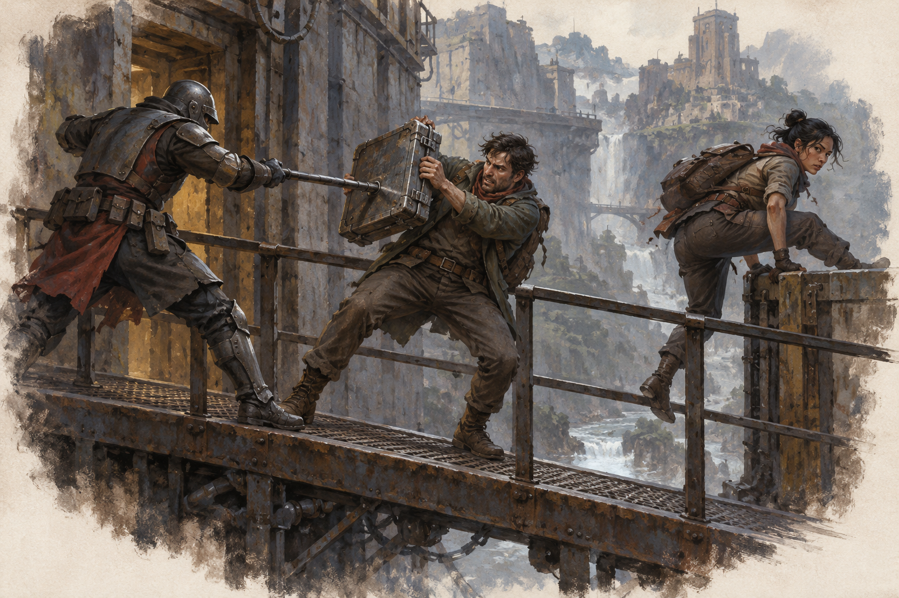

Um combate é uma situação em que posição, tempo, proteção e recursos tornam cada escolha importante. Antes de resolver os números, diga o que pretende alcançar: proteger uma retirada, impedir a fuga ou abrir uma passagem pode importar mais do que derrotar todos os adversários.

### Iniciativa

A Iniciativa organiza a ordem de participação no combate. O padrão usa a rolagem de Destreza, com o mesmo conjunto de dados e bônus que o Atributo normalmente utiliza. O Mestre pode escolher outro Atributo nas regras da mesa.

A ordem dos turnos não define, sozinha, quais ações são possíveis ou seus custos narrativos. Declare a intenção e resolva as escolhas com o Mestre; não há uma economia universal de ações acrescentada por este livro.

### Deslocamento por rodada

Quando o módulo está ligado, cada personagem tem uma reserva de movimento por turno. No padrão, ela começa em **6 m**, ganha **1 m a cada 10 de Destreza permanente** e tem teto de **18 m** nessa parcela. Destreza temporária vinda de Skills soma por cima do teto; modificadores percentuais, como Lentidão, alteram o total. Bônus de Item não entram nessa conta.

O gasto é renovado no início do próprio turno. Movimento ainda disponível pode ser usado fora dele; fora de combate, o limite por rodada não se aplica. **Correr** dobra a reserva daquele turno e só pode ser acionado no próprio turno. O custo narrativo dessa escolha é combinado pela mesa.

### Atacando e sendo atacado

Uma Skill de dano, uma arma pessoal e uma arma de nave usam suas próprias características para calcular o golpe. Antes de contabilizá-lo, o Mestre resolve o que a ação alcançou na cena. Os números descrevem a consequência desse resultado.

O cálculo parte do dano do atacante, considera as escalas e modificadores aplicáveis, encontra eventuais Estruturas no caminho e só então resolve as defesas de cada alvo. Escudo pessoal absorve o que puder; a parte restante chega à Vida. Dano Absoluto tem exceções próprias.

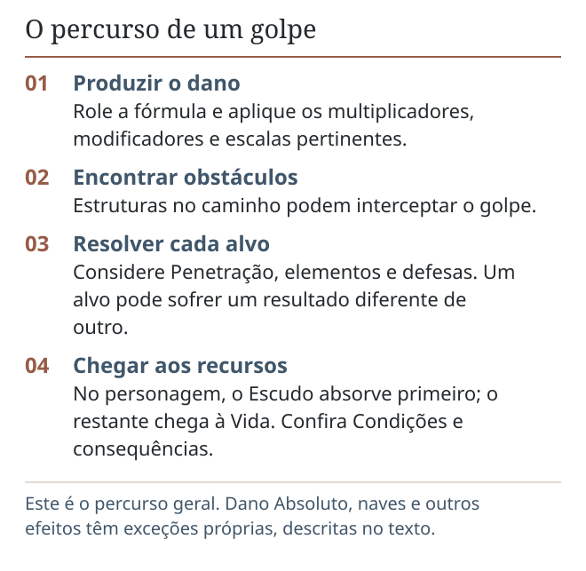

### Defesas contra o seu dano

| Defesa | Quando vale |
|---|---|
| **Defesa Mágica** | Só contra dano marcado como **Mágico**. 2% por ponto de Defesa Mágica do alvo, até 60%. |
| **Resistência Geral** | Contra qualquer dano. Vem de Skills (até 50%) e Títulos. |
| **Resistência ao elemento** | Só contra a parte daquele elemento. 100% ou mais = **Imunidade**. |
| **Penetração** | É do atacante: alguns elementos ignoram parte das defesas acima. Nunca atravessa Imunidade. |

### Dano por elemento

Um golpe com vários elementos é **dividido em partes iguais**, e cada parte sofre só a Resistência do próprio elemento. Assim, ser imune a Fogo não anula a metade de Gelo de um golpe Fogo + Gelo:

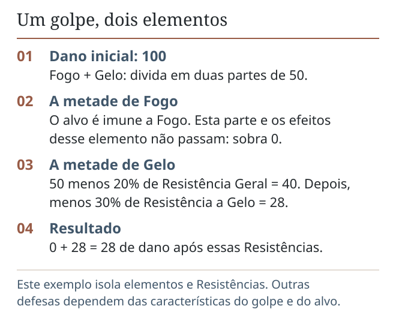

Elementos podem ter efeitos ao acertar, definidos pelo Mestre. Os de fábrica:

| Elemento | Efeito ao acertar |
|---|---|
| Fogo | 25% de chance de **Queimadura** |
| Gelo | 25% de chance de **Lentidão** |
| Plasma *(sci-fi)* | 25% de chance de **Queimadura** |
| Disruptor *(sci-fi)* | Penetração 10% |
| Transfásico *(sci-fi)* | Penetração 40% |
| Pólaron *(sci-fi)* | +20% de dano contra alvos **Orgânicos** |
| Táquion *(sci-fi)* | +30% de dano extra **só no Escudo** |

Quem é imune a um elemento também não sofre os efeitos dele.

### Vantagem entre elementos

Elementos têm vantagem ou desvantagem uns contra os outros, numa tabela do Mestre estilo Pokémon: **Imune** (×0), **Ineficaz** (×0,5), **Neutro**, **Efetivo** (×1,5), **Super efetivo** (×2). Vale contra quem **é** de um elemento:

- **o corpo**: pela Espécie (um Elemental de Fogo), por uma Condição (Encharcado = Água) ou por uma Skill de transformação (Efeito **Elemento do corpo**: "Forma de Chamas" deixa você de Fogo enquanto durar). Virar um elemento muda como você **recebe** dano — os seus ataques continuam com os elementos da Skill/arma. Com dois elementos, as vantagens se multiplicam;
- **um Escudo** de um elemento (Escudo de Água, Escudo de plasma da Nave): o Escudo recebe o golpe com a vantagem contra o elemento dele;
- **uma Estrutura** de um elemento (Parede de Gelo).

Num golpe com vários elementos, cada parte usa a sua vantagem. Dano Absoluto ignora a tabela.

### Dano Absoluto

É **o dano inteiro**, não importa quais elementos venham junto no golpe. **Não pode ser resistido**: ignora Defesa Mágica, Resistências, Imunidade e o Escudo pessoal, e os elementos também não o aumentam nem diminuem (as Condições deles ainda podem pegar). Mas **pode ser evitado**: uma Estrutura no caminho segura o golpe, e uma Nave ainda pode desviar pela Evasão.

### Escala

Se a mesa usa **Escala**, dano entre tamanhos diferentes é multiplicado ou dividido (fator 10 por degrau): **Pessoal → Veículo → Nave → Capital**. Uma pistola faz 1/100 do dano numa Nave; um canhão de Nave faz 100× numa pessoa. Uma arma pode ter a própria escala (uma bazuca anti-tanque pode ser "Veículo" mesmo na mão de uma pessoa).

### Condições

Condições são estados que afetam ou descrevem o personagem: **Cegueira, Veneno, Queimadura, Lentidão, Atordoamento, Silêncio, Paralisia, Medo, Sangramento, Regeneração**.

- Algumas têm efeito numérico automático: Queimadura e Veneno tiram Vida a cada rodada, proporcional ao dano do golpe que as causou; Lentidão corta 50% do Deslocamento; Regeneração cura 5% da Vida máxima por rodada.
- Outras (Cegueira, Atordoamento, Medo…) podem ser **só o marcador**: o Mestre decide o que "estar cego" significa na cena. A exceção são **Caído, Inconsciente, Morto** e Condições configuradas como incapacitantes, que bloqueiam ações automaticamente.
- Ticks por rodada acontecem sozinhos no **início do seu turno**. Ticks **manuais**, como uma cura de longo prazo fora de combate, são aplicados quando a mesa confirma a passagem correspondente.
- Dano por tick é reduzido pelas suas Resistências, mas **não** pela Defesa Mágica. Ticks de cura não sofrem Resistência; bloqueios de cura e limites de Anatomia ainda podem impedir a recuperação.
- **Reaplicar a mesma Condição renova, não acumula**: a duração passa a ser a maior entre a que restava e a nova, e o valor fica o mais forte.
- **Contágio**: algumas Condições (a "Praga" de fábrica, fungos, nanitos…) **passam de um para outro**. No início do turno de quem a carrega, cada personagem perto (no raio dela) rola a chance de pegar. Certos Traços deixam imune, e a sua Resistência ao elemento da Condição diminui a chance. O chat mostra quem pegou e quem resistiu. Só acontece em combate.

### Bônus condicionais

Títulos, Skills e Itens podem ter regras **"Quando → Então"**: um benefício ou penalidade passa a valer quando sua condição é atendida. Exemplos:

- *Quando o oponente tem o Traço Dracônico → +25% de dano causado* (o Título "Caçador de Dragões").
- *Quando minha Vida está abaixo de 30% → +5 no atributo Força* (contínuo: vale para as rolagens enquanto a condição for verdadeira, nunca para a Vida máxima).
- *Quando o dano é do elemento Fogo → +20% de Resistência a Fogo*.
- *… por Condição no oponente* multiplica o valor por quantas Condições o alvo tem.

| "Quando" | "Então" |
|---|---|
| Sempre · Oponente tem o Traço · Oponente é Nave/Veículo · Oponente tem a Condição · O dano é do elemento · Minha Vida abaixo de (%) · Eu tenho a Condição · Estou em combate | % de dano causado · na rolagem de (atributo) · % de Resistência a · no atributo (contínuo) |

"Oponente" é sempre o outro lado da ação: quando você ataca, é o alvo; quando você se defende, é quem atacou.

### Exemplo resolvido — Um golpe e suas consequências

Uma sentinela bloqueia a passagem do grupo. Neris tenta detê-la enquanto Lia ajuda Cora a atravessar. O Mestre resolve o alcance da ação na cena; em seguida, o grupo calcula o dano do golpe.

#### Da intenção ao dano aplicado

Neste exemplo, a Habilidade de Neris causa **100 de dano mágico de Fogo**, já depois de todas as escalas da atacante. Não há Estrutura, Penetração, vantagem elemental ou bônus contra Traços. A sentinela tem Defesa Mágica Total 10, Resistência Geral 20%, Resistência a Fogo 50% e 12 de Escudo pessoal.

| Etapa | Conta | Resultado |
|---|---|---|
| Dano antes das defesas | Valor do exemplo | 100 |
| Defesa Mágica | 10 × 2% = 20%; passa 80% | 80 |
| Resistência Geral | Passa 80% | 64 |
| Resistência a Fogo | Passa 50% | 32 |
| Escudo pessoal | Absorve 12 | 20 chegam à Vida |

O jogador vê o resultado final destinado ao alvo, sem uma exposição pública de suas defesas. O Mestre pode consultar o rastro e confirma o acerto pelo botão **Aplicar**. Se houver uma Condição disparada pelo elemento, ela entra nessa confirmação. Para naves, a aplicação usa outra lógica e é automática; consulte o capítulo próprio.

> **As reduções são sucessivas.** Resistência Geral de 20% e Resistência a Fogo de 50% não viram 70%. Sobre 100 de dano sem outras defesas, deixam passar 100 × 0,8 × 0,5 = 40.

#### Se o golpe tiver dois elementos

Um golpe de 100 com Fogo e Gelo é dividido em duas partes de 50. Se o alvo for imune a Fogo e não tiver qualquer outra defesa ou afinidade relevante, só a metade de Fogo zera. A metade de Gelo continua: **50 de dano**. A imunidade a um elemento não torna o alvo imune ao golpe inteiro.

#### Antes de passar a vez

- Confira a Mana gasta e quais Habilidades Ativas continuam ligadas.
- Observe duração, Condições e eventuais efeitos que começam no seu turno.
- Avise quando uma escolha tiver sido feita por engano; o Mestre dispõe de ferramentas de desfazer com limites próprios.
- Descreva como sua ação mudou a cena. A matemática resolve o efeito; a conversa mantém a aventura em movimento.

---

### No Foundry — Ler o estado do combate

#### Na tela: números e avisos

A mesa é narrada por voz e todo mundo olha o mapa, então o sistema mostra as coisas **sobre o Token**, não só no chat:

- **Números flutuantes**: quando a Vida, o Escudo ou a Mana mudam, o número sobe do Token — **vermelho** dano, **verde** cura, **azul** Escudo, **roxo** Mana (Nave: Escudo, Casco e Integridade). Você vê o número exato do golpe; a Mana de alguém só o dono e o Mestre veem. Condições entrando e saindo ("+Envenenado") o próprio Foundry já mostra.
- **Números sobre os ícones de efeito** no Token: **amarelo** = rodadas ou ticks que faltam; **∞ ciano** = dura até a Habilidade Ativa ser desligada; **verde-limão** = nível de irradiação; **vermelho** = o contador do Caído/Inconsciente. Efeitos sem prazo não mostram número. Você vê os números só nos Tokens que controla (o Mestre vê em todos).
- **Voz do Mundo na tela**: os anúncios para você (subiu de nível, XP cheio, Skill nova…) aparecem como um card dourado no topo da tela por alguns segundos (clique fecha). O sussurro no chat continua, como registro.

As três coisas têm opção para desligar **só no seu navegador**, em *Configurações → Configurar Definições → Nihility RPG System*: **Números flutuantes sobre o Token**, **Duração sobre os ícones do Token** e **Voz do Mundo na tela**.

#### Janela de Efeitos

O botão **✦ Efeitos** (no topo da ficha, ao lado de Iniciativa; na Nave, ao lado da Classe) abre uma janela com **tudo o que está agindo sobre você** agora, em palavras: cada efeito (de onde veio, o que muda — "Força +3", "Vida −5 por rodada", "Deslocamento −50%" — e quanto falta), o Escudo e os pools dele, Escudos que você mantém em alguém (com **Regenerar agora**, para fora de combate), Habilidades Ativas ligadas e o custo por rodada, Estruturas que você mantém, efeitos que somem no próximo turno e sobrecarga de peso. Na Nave: efeitos de sistema, Raio Trator e o que o Escudo adaptativo já aprendeu. A janela se atualiza sozinha; só o Mestre encerra efeitos por ela.

#### Mover o Token e correr

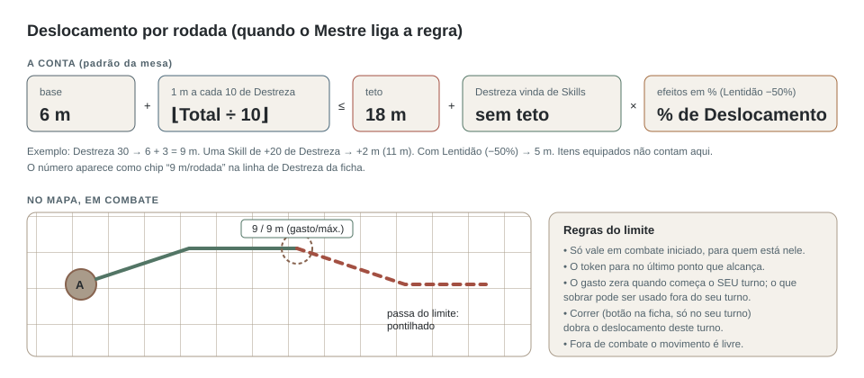

Se a mesa ligou esta regra, a linha da Destreza mostra um chip como **"9 m/rodada"** (passe o mouse para ver de onde vem cada parte).

- **Base 6 m + 1 m a cada 10 de Destreza**, com teto de **18 m** para a parte que vem dos seus pontos e Títulos.
- Destreza vinda de Skills soma **por cima do teto** (e diminui se for um debuff).
- Efeitos em %, como **Lentidão (−50%)**, valem sobre o total.
- Itens não contam.

No mapa, em combate:

- a régua do Token mostra **gasto / máximo**;
- o trecho que passa do limite fica **pontilhado** e o Token para no último ponto que alcança;
- o gasto zera quando começa **o seu turno**; o que sobrar pode ser usado fora dele;
- **Correr** (botão no cabeçalho, só no seu turno) **dobra** o deslocamento daquele turno;
- fora de combate, e para quem não está no combate, o movimento é livre.

#### Confirmar o dano no chat

Os três jeitos de causar dano — **Usar** uma Skill de Dano, **Atacar** com uma arma equipada e **Disparar** uma arma de nave — seguem o mesmo caminho:

O que você vê no chat:

- a **rolagem bruta** (os dados são públicos);
- ao final, o **número final de cada alvo**: `— Goblin: 37`, e se algum elemento aplicou Condição, `— causa Queimadura`.

O chat **nunca mostra quanto foi reduzido nem por quê**. As defesas do alvo são segredo dele — você só vê o resultado.

O dano **não sai da Vida sozinho**: o Mestre clica **Aplicar** (ou **Metade**/**Dobro**) no card. O Escudo pessoal absorve primeiro, e as Condições do elemento só entram nesse clique. Se ele errar, há **Desfazer**, que volta os valores exatos.

#### Rolar Iniciativa no aplicativo

Clique **Iniciativa** no cabeçalho. Ela rola o seu pool de **Destreza** — o mesmo `Nd20 + fixo` de qualquer rolagem de Atributo, com bônus de item — e lança o valor no rastreador de combate.

- É preciso haver um combate criado.
- Se o seu personagem ainda não está no combate, aparece um aviso para pedir ao Mestre que o adicione.
- Shift + clique funciona aqui também.

## 9. Experiência e reconhecimento

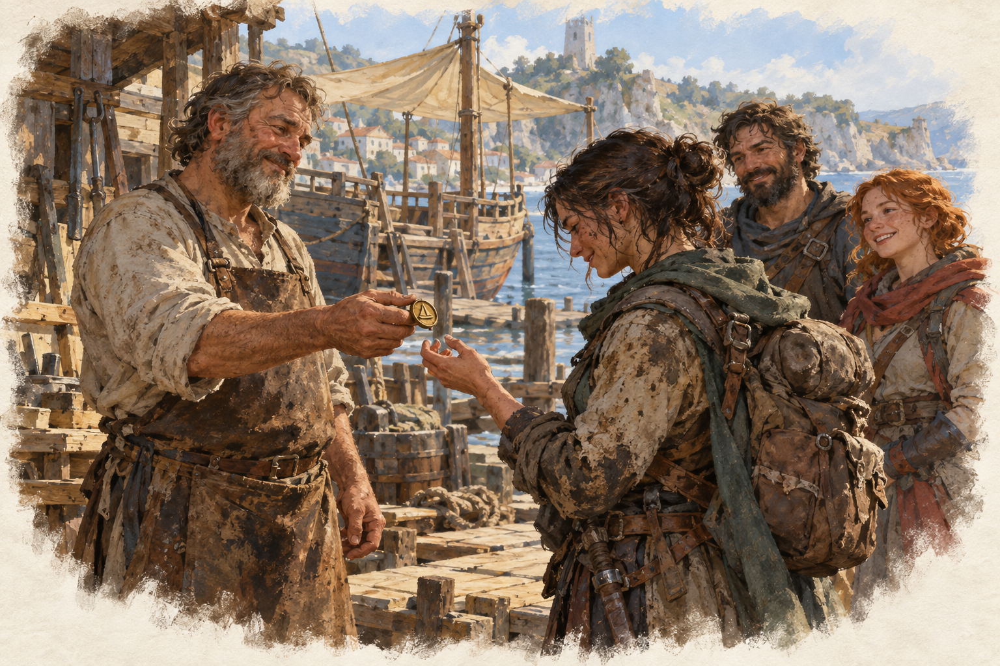

Experiência acompanha o desenvolvimento, mas personagem e Skill têm progressões distintas. Um personagem pode aprender com a aventura enquanto uma Skill se desenvolve pelo uso; o avanço de um não substitui o do outro.

- O **XP** do personagem e de cada Skill fica num bloco que **só o Mestre vê**. Ele concede XP e decide quando subir o nível.
- Skills de Resistência ganham XP sozinhas ao bloquear dano, e as outras Skills pelo uso (veja [O que acontece ao clicar em Usar](#o-que-acontece-ao-clicar-em-usar)).
- No **fim de um combate**, o Mestre pode distribuir a XP da luta entre os personagens que participaram; o anúncio chega pela Voz do Mundo.

**Ao subir de nível**:

- +5 Pontos de Atributo no pool (distribua e confirme);
- +2 Pontos de Habilidade Normais (entram sozinhos).

### Títulos e reconhecimento

Depois de ajudar uma comunidade, o grupo pode voltar a ser recebido de outra maneira. Os feitos e a reputação deixam marcas na história dos personagens.

Títulos registram feitos e o reconhecimento que uma pessoa recebe, como "Caçador de Dragões", "Herói de Ashcroft" ou "Rei de seu Reino". Eles também podem expressar uma reputação indesejada: nem todo Título é uma honraria. O Mestre apresenta o Título conquistado e seus efeitos.

Os efeitos de um Título estão **sempre ativos** — não é preciso equipá-lo. Um Título pode ter:

- **Bônus permanentes** em Atributos (entram no **Total**, portanto contam para Vida/Mana e rolagem) ou direto em HP/Mana máximos;
- **Resistência a dano** — um percentual fixo, Geral ou por elemento. Soma com a Resistência de Skill do mesmo tipo;
- **Bônus condicionais**.

A concessão registra quem reconheceu a conquista e sua raridade.

---

### No Foundry — XP, níveis e anúncios

#### Voz do Mundo

É o canal de anúncios privados do sistema: aparece no chat **só para você e para o Mestre** (sussurro). Anuncia subidas de nível, XP cheio, XP de combate, Skills aprovadas, Fusões, Evoluções, Heranças, Resistências ao alcance e pontos devolvidos.

Além do chat, cada anúncio aparece como um **card dourado no topo da sua tela** por uns 6 segundos (clique fecha). Para desligar só o card, veja [Na tela: números e avisos](#na-tela-números-e-avisos).

## 10. Anatomia e modificações corporais

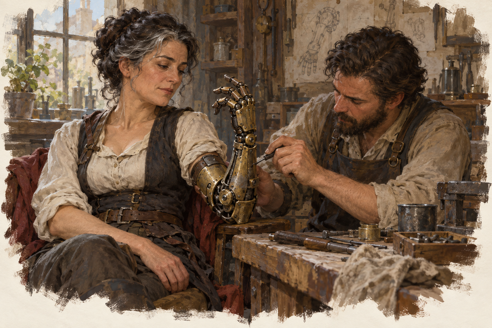

O módulo de Anatomia divide o corpo em **Partes**, cada uma com Vida própria, o **slot** (head, arm, leg…) e as **Funções** que ela tem: a cabeça vê e ouve, o braço manipula (a mão faz parte do braço), a perna anda, a asa voa.

Implantes e próteses modificam o corpo de maneiras diferentes. Uma prótese substitui uma parte; um implante aprimora uma parte natural. Os benefícios dependem da instalação e das condições da parte afetada.

- **Prótese** substitui a parte: a Vida da parte passa a ser a da prótese, e as Funções vêm dela (um braço destruído com prótese volta a manipular).
- **Implante** aprimora a parte natural e soma Funções; se a parte for destruída, ele para.
- Bônus, Vida/Mana e a Habilidade do Item valem **enquanto instalado**.

**Ferimentos por parte** (só se o Mestre ligou esse bloco): perder uma parte desliga as Funções dela, com as seguintes consequências:

- **visão**/**audição**: Cego/Surdo quando não sobra nenhuma parte que veja/ouça;
- **manipulação**: "Sem mão" (com quantas);
- **locomoção**: o Deslocamento cai na proporção das pernas que ainda andam (perna ferida conta pela Vida). Sem nenhuma, você se **arrasta 1 m** por rodada se ainda tiver uma mão funcionando; sem nenhuma das duas, fica parado;
- **voo**: perder uma asa tira o Traço Voador;
- **vital**: avisa o Mestre — o sistema não mata ninguém sozinho.

As Condições somem sozinhas quando a parte volta a funcionar ou ganha uma prótese.

**Vida da parte.** Cada parte tem um **% da sua Vida máxima** (cabeça 30%, braço 20%, perna 25%…) e cresce com você: subir de nível ou ganhar um buff de Vida aumenta o máximo das partes sem ferir nem curar nenhuma. Com Ferimentos por parte, o dano direto de alvo único confirmado também pode atingir uma parte: a mirada ou uma sorteada, com maior chance para partes maiores. Dano em área e ticks periódicos não danificam partes nesse fluxo.

| Estado | O que é | Volta com |
|---|---|---|
| **Ferida** | machucada | Cura ou Regeneração |
| **Inutilizada** | Vida 0: existe, mas não funciona | Cura ou Regeneração |
| **Perdida** | decepada, não existe mais | **Regeneração**, ou Cura de nível 10 ou mais no padrão |
| **Prótese** | o Item no lugar da parte | só **Reparo** (ou a Regeneração de uma Skill Única/Ultimate) |

Uma parte vira Perdida quando um golpe passa do 0 com sobra grande (padrão: metade da Vida dela), quando o elemento do golpe tem **Decepar**, ou quando o Mestre marca. A Vida que uma cura devolve é repartida entre as partes feridas (uma Skill de cura pode **focar** numa parte). Uma parte a 0% que a cura não conserta segura o % dela na sua Vida. **Fogo**, **Ácido** e **maldições** podem bloquear a cura — uma cura de nível bem maior que o bloqueio passa (cada vez mais, quanto maior a diferença).

Um **Descanso Curto** devolve parte da Vida e da energia; um **Completo** recupera as reservas, respeitando os limites abaixo. Partes a 0% não voltam com descanso e seguram a Vida abaixo do máximo; as feridas melhoram com a Vida que você ganhou.

**Antimagia.** Sob **Suprimido**, seus passivos, Resistências, itens e implantes **Mágicos** param de valer, suas Skills mágicas não funcionam e Skills mágicas ou curas usadas em você não têm efeito (dano em área ainda acerta). Racial que não gasta energia (Couro Grosso) continua.

### No Foundry — Instalar e remover modificações

**Implantes e próteses são Itens.** Arraste um Item com **Implante** ligado para uma parte: enquanto você arrasta, as partes onde ele cabe ficam verdes e as outras vermelhas, com o motivo. Instalar tira o Item do inventário; o **×** no implante o devolve.

---

## 11. Ambiente, Estruturas e Antimagia

A cena pode oferecer proteção e também impor perigos. Estes módulos acrescentam decisões sobre o espaço: o que bloqueia um ataque, o que enfraquece a magia e o que torna perigoso permanecer num lugar. Verifique quais deles a campanha utiliza.

### Estruturas

Skills de **Estrutura** erguem **Parede de Pedra**, **Bloco de Gelo**, **Barreira de Mana**… (catálogo do Mestre) como paredes de verdade no mapa:

- bloqueiam movimento (e visão, se o catálogo mandar);
- todo mundo vê a faixa colorida, o nome e a barra de Vida (os números só o Mestre vê);
- **bloqueiam ataques**: um golpe cuja linha atravessa a Estrutura bate nela primeiro, até a Vida dela, e só o resto chega no alvo — **inclusive Dano Absoluto**;
- quem ergueu a Estrutura atira de dentro dela sem ser bloqueado;
- a **animação** de uma Skill para no ponto em que bate na Estrutura, e só segue até o alvo se sobrou dano;
- **Barreira de Mana** (Vida 0 no catálogo): o dano que ela leva sai da **sua Mana**, e ela cai quando a sua Mana acaba.

Uma Estrutura cai quando: a Vida dela chega a 0; acabam as rodadas de duração; você desliga a Skill (se for Ativa e sem prazo); o Mestre a derruba; ou a sua Vida ou Mana chega a 0.

Ao cair, ela deixa de bloquear na hora, mas o desenho some com uma animação curta, pra todo mundo entender o que aconteceu: **racha e estilhaça** se foi destruída, **pisca e se desfaz** se acabou a Mana que a mantinha (ou a antimagia venceu), e **dissolve devagar** se o prazo acabou ou a Skill foi desligada. O card do chat diz como ela caiu.

**Estruturas com elemento:** uma Parede de Gelo é de Gelo — um golpe de Fogo bate mais forte nela, pela tabela de vantagens entre elementos. Algumas Estruturas não seguram golpes e **queimam quem as atravessa** (Muralha de Fogo): atravessar ou terminar o movimento dentro dela rola o dano de contato contra você, com as suas defesas valendo normalmente.

### Antimagia

Uma Skill que custa energia (Mana, Ki… o nome da sua mesa) é **Mágica** por padrão; o Mestre pode desmarcar ("Mágica: Não"), e também marcar uma que não custa nada. Magia sofre **Antimagia**, que tem nível:

- **Campo Antimagia** (uma Estrutura): um ataque mágico cuja linha **atravessa** o campo, que **sai de dentro** dele ou que mira alguém **dentro** dele paga energia a mais na hora. Quanto maior o nível, muito mais caro. Se você não tem como pagar, o ataque é **anulado** (vale até para Dano Absoluto mágico).
- **Selo Antimagia** (uma Condição): toda magia de quem está selado paga o mesmo custo extra.
- **Magia contínua**: uma Habilidade Ativa mágica usada dentro de um campo (ou sob Selo) paga o extra **por rodada**, junto do custo por rodada; se não der, ela desliga. Uma Estrutura mágica dentro de um campo cobra o extra de quem a conjurou a cada rodada, ou se desfaz.

O chat mostra quanto foi cobrado ("antimagia nível 2: +90 Mana") ou que o ataque foi anulado.

### Ambiente e densidade de mana

O lugar pode ser perigoso por si só: vácuo, gás venenoso, calor extremo, uma sala sem ar. O Mestre marca isso na cena inteira ou numa área do mapa, e quem está lá **ganha a Condição** do perigo enquanto ficar — e perde ao sair. Alguns Traços deixam imune (um Androide não respira, então gás não o afeta).

A **densidade de mana** do lugar muda a força da magia:

- **1** é o normal;
- acima de 1 (um nexo arcano), Skills **mágicas** ficam mais fortes — dano, Efeitos e a Vida das Estruturas — e a Mana regenera mais;
- abaixo de 1, ficam mais fracas;
- em **0**, magia não funciona ali: a Skill é recusada antes de cobrar a Mana.

O **Custo** e o Custo por Rodada não mudam com a densidade. A janela ⓘ "De onde vem" mostra o fator do lugar onde você está.

### Radiação

Um lugar (ou um Token, como um reator vazando) pode ter um **nível de radiação**. Quem fica lá vai sendo **irradiado**:

- a cada rodada, a sua irradiação **sobe** em direção ao nível do lugar (mais rápido perto de uma fonte forte) — o ícone **Irradiado** no Token mostra o número;
- você leva **dano por rodada** proporcional à sua irradiação, direto na Vida (o Escudo não segura). Resistência Geral e Resistência a Radiação reduzem;
- fora da radiação, a irradiação **cai** devagar (padrão: 10% por rodada), e o dano cai junto;
- perto de um Token que emite, a exposição diminui com a distância.

Fora de combate, o Mestre pode "passar o tempo" e aplicar várias rodadas de uma vez. Para se curar de vez da irradiação, fale com o Mestre.

### No Foundry — Posicionar uma Estrutura

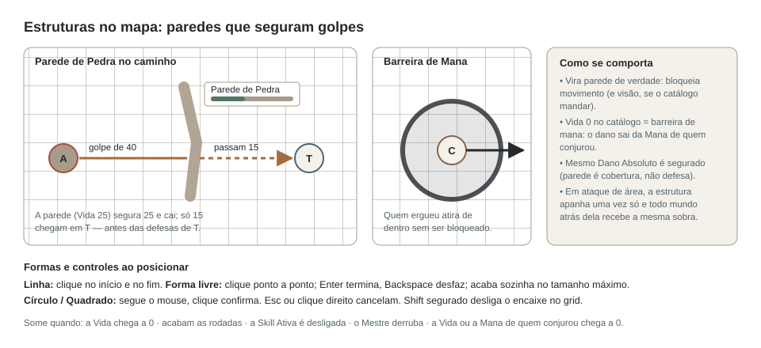

Para posicionar:

| Forma | Como |
|---|---|
| **Linha reta** | clique no início e depois no fim |
| **Forma livre** | clique ponto a ponto; **Enter** termina, **Backspace** desfaz o último; acaba sozinha no tamanho máximo |
| **Círculo** / **Quadrado** | segue o mouse; clique confirma |

**Esc** ou clique direito cancelam. Segure **Shift** para posicionar sem encaixar no grid.

---

## 12. Naves, veículos e tripulação

Uma nave é um recurso compartilhado e um conjunto de sistemas que dependem uns dos outros. Tripular envolve coordenar prioridades: energia desviada para um sistema pode faltar em outro, e dano a um Módulo altera o que o grupo ainda consegue fazer.

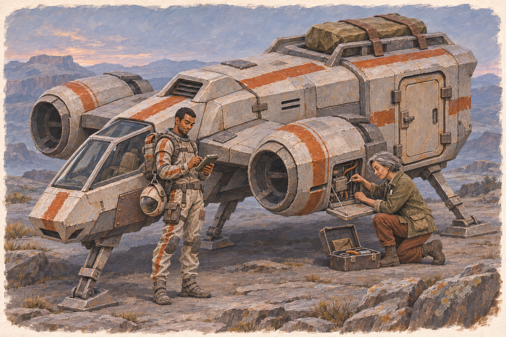

Esta seção só vale se a sua mesa usa Naves e Veículos.

### Tripulação

Ícaro acompanha a rota; Cora observa o estado dos sistemas; Doran prepara um reparo. Os postos ajudam o grupo a organizar a cena e a comunicação durante a viagem.

Cada personagem incluído na tripulação tem um **posto** (Capitão, Piloto, Engenheiro, Tático, Ciências, Médico…), mas o posto só diz **quem está onde**: **qualquer tripulante opera a Nave inteira** — ajusta energia, dispara, usa as Skills da Nave — e pode trocar seu próprio posto. Ao sair da tripulação, você perde esse acesso.

### Energia

No topo de **Sistemas**:

- **Reator** gera energia por rodada;
- **Distribuidor** é o teto do que a nave consegue entregar por rodada;
- **Capacitor** é a reserva (vem da Bateria; sem Bateria, os conduítes do casco guardam um pouco). É dele que sai o Custo das Skills da Nave;
- **Demanda** compara o consumo dos Módulos ligados com o que a nave entrega, e avisa quando falta.

Em cada linha de Módulo você controla:

| Controle | O que faz |
|---|---|
| **P1…P5** | Grupo de prioridade. Clique desce um grupo; clique direito sobe. Quando falta energia, P1 é abastecido primeiro; um grupo que não cabe inteiro divide o que sobra **por igual**; os grupos seguintes ficam sem. |
| **Throttle** (⏬ − valor + ⏫) | Potência do Módulo, em %. Abaixo de 100% economiza energia e rende menos. Acima de 100% rende mais e **sobrecarrega**: o Módulo perde Vida a cada rodada (o Reator sofre com qualquer valor acima de 100%; outros Módulos toleram mais). |
| **Liga/Desliga** | Módulo desligado não consome nem funciona. Um Módulo com Vida 0 desliga sozinho e só volta a ligar com pelo menos **15%** da Vida. |

Um Módulo rende proporcionalmente à própria Vida (a 50% de Vida entrega 50%) e à energia que recebe (aparece "⚠ recebendo 60% da energia pedida").

**Foco de energia** — no topo do Grid (e na tela Nave do PAD) há quatro atalhos: **Escudos**, **Armas**, **Motores** e **Equilibrado**. Escolher um sistema sobe o throttle dos Módulos dele (padrão 150%, nunca acima do ponto em que começa a Sobrecarga) e os põe em P1; os outros dois caem (padrão 75%) e vão pra P3. **Equilibrado** volta tudo a 100%. Reator, Bateria, Distribuidor e os outros Módulos não mudam. Depois do atalho você ainda pode ajustar cada Módulo à mão.

### Raio Trator

Um Módulo de **Raio Trator** ligado ganha o botão 🧲 na linha: escolha a Nave/Veículo alvo e ela fica **presa** — o deslocamento dela cai conforme a diferença de Porte (mesmo Porte do Módulo ou menor: 100%; um acima: 50%; dois: 25%; mais que isso, grande demais). Throttle acima de 100% segura mais. O alvo fica preso enquanto o Módulo estiver ligado; o botão ⛓ solta. Cada Raio segura um alvo por vez.

### Armas

Na aba **Armas**, cada arma mostra Porte, Dano, Penetração e Throttle.

- **Disparar** rola o dano e escolhe o alvo como uma Skill Targetada (Shift para modificadores).
- Depois de disparar, a arma entra em **Recarga** (⏳ rodadas); o botão fica desabilitado até zerar. A contagem desce no início de cada turno da nave.
- **Throttle acima de 100% numa arma não a danifica**: aumenta Dano e Penetração **e** alonga a Recarga na mesma proporção.

### Dano na Nave

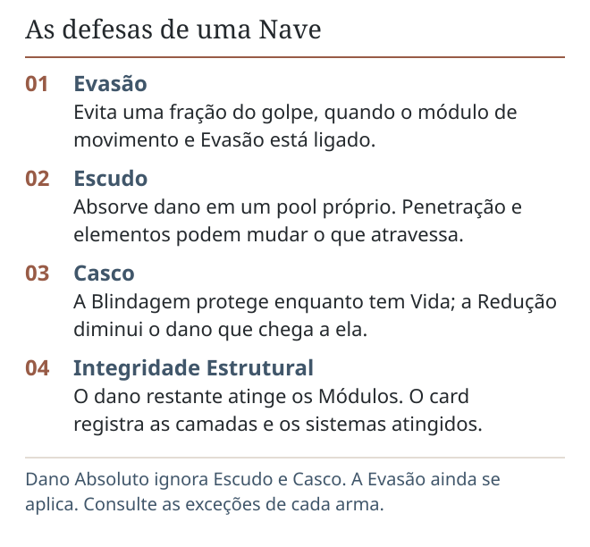

Diferente de personagens, a Nave **aplica o dano sozinha**, camada por camada: **Evasão → Escudo → Casco → Integridade Estrutural**. O dano que chega na Integridade cai em pedaços aleatórios em Módulos sorteados — cada golpe quebra sistemas diferentes. O card do chat mostra quanto foi para cada camada e quais Módulos foram atingidos.

- **Escudo e Casco resistem à Penetração**: cada camada tira pontos da Penetração da arma antes de separar o que passa direto.
- **Cada arma tem o seu jogo de camadas**: arma de energia (Phaser) é forte no Escudo e fraca no Casco; torpedo e cinético são fracos no Escudo e fortes no Casco.
- **Mirar num sistema**: ao atirar numa Nave, dá pra escolher um Módulo (Motor, Armas, Escudo…) e concentrar nele o dano que passar das defesas.
- **Escudo adaptativo**: um Módulo de Escudo marcado como Adaptativo aprende cada golpe que segura — ganha resistência àquele elemento, na frequência das armas de quem atacou, até um teto (nunca 100%). Perde tudo quando o Escudo cai ou o Módulo desliga. Contra ele: **Modular frequência**, ou trocar de elemento.
- **Efeitos de sistema**: alguns elementos, depois de passar do Escudo, podem derrubar um Módulo, drenar energia ou baixar as defesas por algumas rodadas. Escudo de pé e Módulos com **Endurecimento** protegem.

### Habilidades da Nave

A aba **Habilidades** lista as Skills concedidas pelos Módulos ligados. Usam-se **exatamente como as suas** — Sub-Skills, Emissão, Zona, Estrutura e Shift para modificadores funcionam igual —, mas o Custo sai do **Capacitor**, e o Custo por Rodada das Ativas é descontado da geração do Reator enquanto estiverem ligadas.

Uma Skill de Efeito Temporário da Nave pede o alvo como qualquer Skill Targetada, **com a própria Nave já marcada**: confirmar aplica nela mesma; escolher outra Nave (ou um tripulante) aplica nela. Skills marcadas **Si mesmo** não perguntam.

### Porão e munição

Com o Inventário ligado, a aba **Sistemas** mostra o **Porão** da Nave (em Veículo, "Porão / Peças"). Os slots vêm dos **Módulos de Porão** (Compacto 10, Standard 20, Robusto 40, Industrial 80, Colossal 160, vezes o multiplicador do Módulo; vários somam). Não há limite de peso, mas, se a mesa usa **Peso limita o Deslocamento**, a carga pesa no Motor: menos Movimento e Evasão (o Porão mostra "massa ×1,5 (Motor −33%)"). Mais energia nos Motores compensa.

Uma arma marcada como **lançador** (Usa munição) só dispara com **Munição** compatível no Porão: o tipo tem que ser aceito pelo lançador (Torpedo, Mina…) e, às vezes, o lançador precisa ter um Porte mínimo. Ao disparar, escolhe-se a munição (se houver mais de uma); rola-se a **fórmula da munição**, com os elementos e o Dano Absoluto dela, a Penetração dela soma à do lançador, e gasta **1 da pilha**. Sem munição compatível, o lançador não dispara.

### No Foundry — Operar a nave

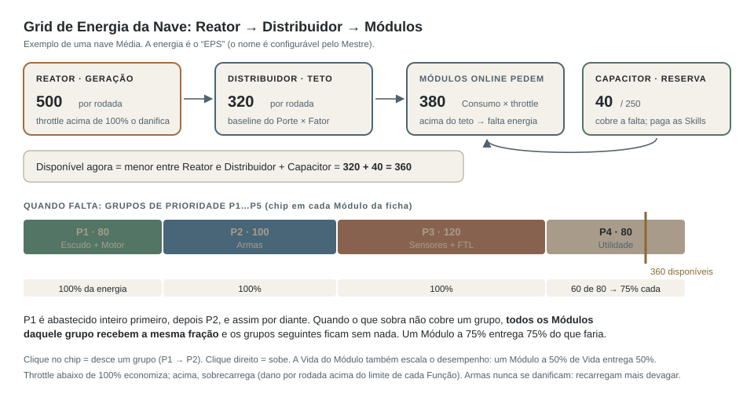

#### A ficha da Nave

**Cabeçalho**: tipo (Nave Espacial ou Veículo), **Porte** (o tamanho) e **Classe** (o tipo: Caça, Tanque…), que só o Mestre muda — cada Classe aceita uma faixa de Portes —, Traços, e as barras:

- **Escudos** — valor atual/máximo, e a **Recarga** quando ele zerou;
- **Casco** — é a Vida dos Módulos de Blindagem;
- **Integridade Estrutural** — soma da Vida dos Módulos (menos Casco, Escudo e Armas);
- **Movimento** (casas por rodada) e **Evasão** (% de cada tiro que a nave evita), se a mesa usa Movimento e Evasão de naves. Sem essa regra, aparece **Manobra** (Nave) ou **Velocidade** (Veículo);
- **Combustível/Bateria** (só Veículo).

**Abas**: **Sistemas**, **Armas**, **Habilidades**, **Tripulação**, **Registro** (diário de bordo em texto livre).

#### Ações da Nave

Logo abaixo do Grid, para quem é da tripulação:

- **Preparar para impacto** — até o próximo turno da Nave, todo dano recebido cai X% (padrão 30%), antes do Escudo. Não vale contra Dano Absoluto.
- **Energia auxiliar → Escudos** — passa carga do Capacitor para o Escudo (você escolhe quanto, até o Escudo encher).
- **Reparo de emergência** — abre o Pedido de Reparo já com esta Nave.
- **Reiniciar sistemas** — encerra um efeito de sistema (Módulo derrubado, energia drenada, resistência baixa). O ↺ ao lado de cada efeito da lista reinicia aquele; o botão grande, o primeiro da lista.
- **Modular frequência** — as armas da sua Nave passam a uma frequência nova: um **Escudo adaptativo** inimigo, que já tinha aprendido a segurar as suas armas, começa do zero contra elas.

A lista embaixo mostra todos os efeitos de sistema ativos e quantas rodadas faltam. O sistema aplica as ações; quanto de ação cada uma gasta, a mesa decide.

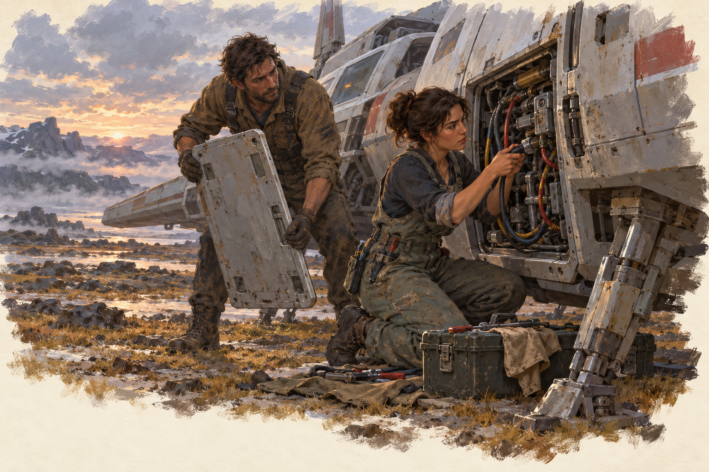

#### Reparo em campo

Use **Reparo de emergência** na ficha da Nave ou a macro **Pedido de Reparo** (o Mestre a cria na barra de macros; ela só funciona com uma Nave na cena). Escolha a Nave, **o que** reparar (os Escudos ou qualquer Módulo — o Casco e a Integridade Estrutural se reparam consertando os Módulos deles) e **quem conserta**: a lista mostra **toda a tripulação da Nave**, com quem está no posto de **Engenharia** em destaque no topo (★) — quem está na Engenharia **restaura mais Vida**: 2d6 **+ 1d6** (fórmula do Mestre); sem tripulação, aparecem os seus Personagens na cena. O Mestre recebe o pedido, rola **Destreza** do engenheiro e, se julgar que deu certo, clica **Restaurar Vida** (2d6 de Vida, sem passar do máximo). Consertar algo grande leva mais tentativas.

---

## 13. Comunicação e PAD

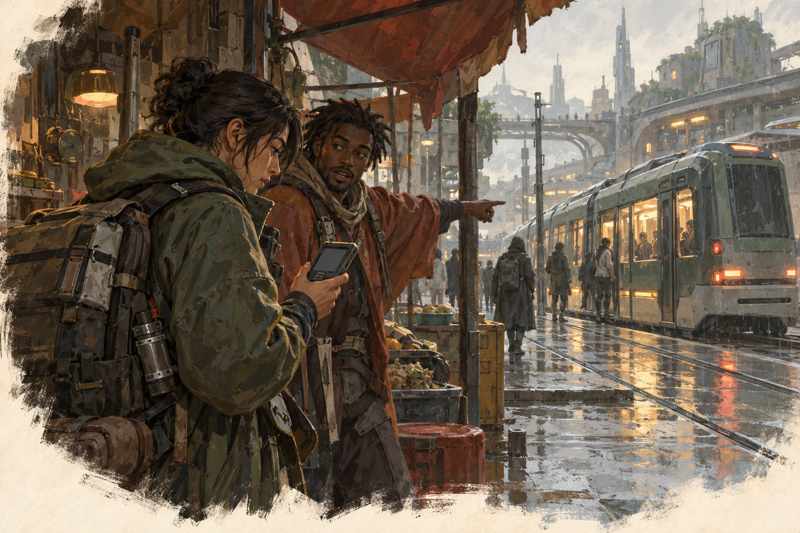

O PAD é um dispositivo de comunicação e consulta dentro da história. Sua presença, a conexão com naves, a Biblioteca e as Mensagens dependem da campanha. As conversas fazem parte do jogo: o Mestre recebe cópia delas e pode representar NPCs.

### No Foundry — Usar o PAD

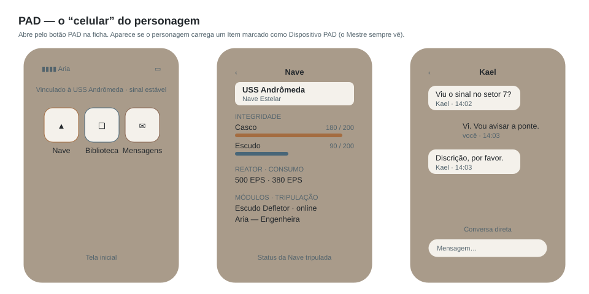

O PAD é um aplicativo em forma de celular, aberto pelo botão **PAD** da ficha. O botão aparece se o seu personagem carrega pelo menos um Item marcado pelo Mestre como **Dispositivo PAD** (não precisa estar equipado).

Três telas, que o Mestre pode ligar ou desligar uma a uma:

- **Nave** — status da Nave/Veículo que você tripula: Casco, Escudo, Reator, Consumo, Módulos e tripulação, com **Ver Ficha Completa da Nave**. Tripulando mais de uma, escolha no topo.
- **Biblioteca** — favoritos. **Arraste** um Item, Registro (nota) ou Ator para a tela para salvá-lo. A aba **Pessoal** é só sua; a aba **Da (nome da Nave)** é compartilhada com a tripulação. **✕** remove.
- **Mensagens** — conversas diretas e em grupo entre personagens:
  - **Contatos**: personagens de jogadores visíveis, seus colegas de tripulação e contatos que você salvou;
  - **Compartilhar Meu Contato**: envia seu contato para quem está na cena; quem recebe clica **+ Adicionar** em **Contatos Compartilhados**;
  - **+ Novo Grupo**: dê um nome, marque os membros e **Criar Grupo**;
  - mensagens novas mostram um número no ícone e no botão PAD da ficha.

> **Privacidade:** o Mestre recebe cópia de **todas** as conversas do PAD. Ele pode também falar como qualquer NPC. Mensagens do PAD não aparecem no chat normal do Foundry.

---

## Apêndice A. A ficha no Foundry

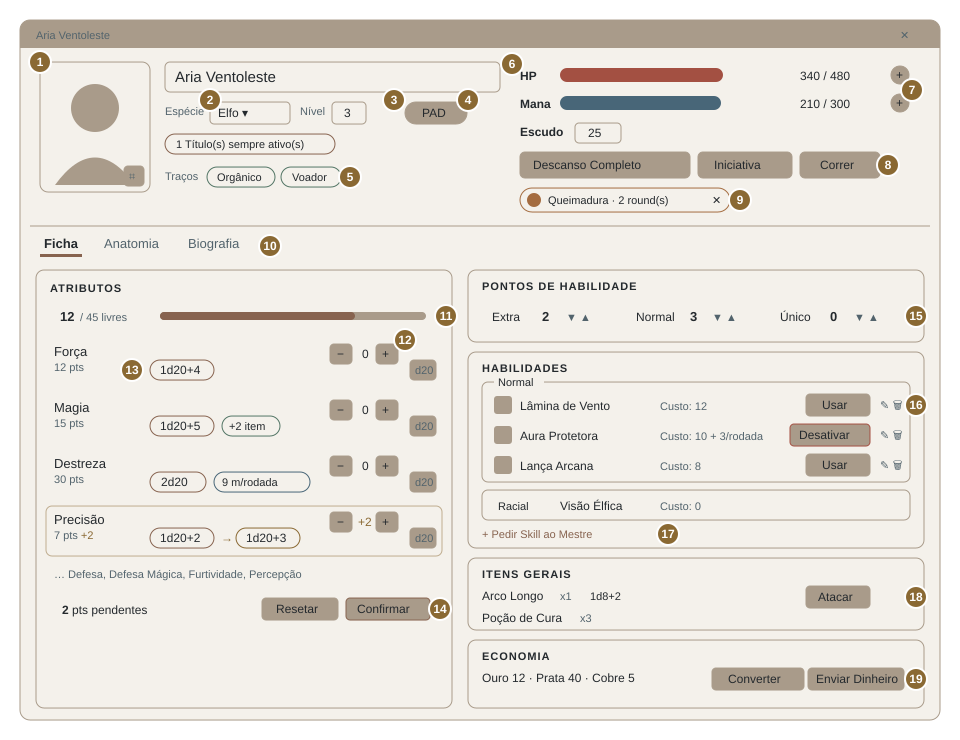

| # | O que é | Como funciona |
|---|---|---|
| 1 | **Retrato** | Clique para trocar a imagem. O botãozinho no canto ajusta o enquadramento (zoom e posição). |
| 2 | **Espécie** | Veja [Escolhendo a Espécie](#escolhendo-a-espécie-e-a-linhagem). Depois de travar, vira uma linha-resumo que abre a aba Origem. |
| 3 | **Nível** | Só leitura para você. Quem sobe o nível é o Mestre (o **+** dourado só aparece para ele). |
| 4 | **PAD** | Abre o celular do personagem. Só aparece se você carrega um Item marcado como PAD. Um número vermelho indica mensagens não lidas. |
| 5 | **Traços** | Etiquetas do personagem (Orgânico, Voador…). Vêm da Espécie; só o Mestre acrescenta ou retira. |
| 6 | **HP e Mana** | Barras com valor atual e máximo. Dá para digitar o valor atual direto no campo. |
| 7 | **+** ao lado da barra | Abre um campo rápido: digite um número e clique **− Dano**/**+ Cura** (HP) ou **− Gastar**/**+ Restaurar** (Mana). Nunca passa de 0 nem do máximo. |
| 8 | **Descansar…**, **Iniciativa**, **Correr**, **✦ Efeitos** | Descansar abre a escolha **Curto** ou **Completo** (use quando o Mestre disser que houve descanso — veja [Recuperação e descanso](#recuperação-e-descanso)). Iniciativa rola e entra no rastreador de combate. Correr só aparece se a mesa usa Deslocamento por rodada. ✦ Efeitos abre a [Janela de Efeitos](#janela-de-efeitos). |
| 9 | **Condições ativas** | Queimadura, Veneno, buffs… com rodadas ou ticks restantes. O **✕** remove (ex.: foi curado). A ampulheta aplica um tick manual. |
| 10 | **Abas** | **Ficha**, **Inventário**, **Anatomia** (se a mesa usa), **Origem** e **Biografia**. |
| 11 | **Pool de Pontos de Atributo** | Quantos pontos ainda estão livres. |
| 12 | **− / +** | Alocar pontos (ficam pendentes até confirmar). |
| 13 | **Fórmula de dados** e botão **d20** | O pool que o Atributo rola hoje. O botão rola no chat. |
| 14 | **Resetar / Confirmar** | Descarta ou grava os pontos pendentes. Em modo criação, o Confirmar espera a liberação do Mestre. |
| 15 | **Pontos de Habilidade** | Extra, Normal e Único, com **▼** (quebrar) e **▲** (juntar). |
| 16 | **Habilidades** | Suas Skills agrupadas por tier, com **Usar** ou **Desativar** e, embaixo do nome, a [Skill numa frase](#a-lista-de-habilidades-na-ficha). ✎ abre a ficha da Skill. Dá para arrastar a linha para a [hotbar](#skills-e-armas-na-hotbar). Pedidos ainda não aprovados aparecem tracejados, com **aguardando** ou **ajustar**. |
| 17 | **+ Pedir Skill ao Mestre** | Monta o pedido de uma Skill nova, que gasta 1 Ponto de Habilidade quando o Mestre aprova. O botão diz quantos pontos ainda estão livres. |
| 18 | **Itens Gerais** | Inventário. Armas equipadas ganham o botão **Atacar** (e **⟳ Recarregar**, se tiverem carregador); consumíveis ganham **Usar**. |
| 19 | **Economia** | Moedas, peso total, **Converter** e **Enviar Dinheiro**. |

A linha do **Escudo** só aparece enquanto você tem Escudo acima de 0.

**Blocos vazios ficam escondidos.** Títulos, Pontos de Habilidade, Itens, Economia, a aba Anatomia e as faixas de tier sem nenhuma Skill não aparecem enquanto estão vazios. O pé da ficha diz quantos foram escondidos, com **mostrar** para ver tudo (a escolha fica lembrada neste navegador). Nada é apagado; o bloco volta sozinho quando ganha alguma coisa.

A aba **Biografia** tem o **Conceito** (a frase de quem é o personagem), três campos de **Personalidade** (Traços, Desejos, Estado Emocional) e o texto livre da biografia. A Personalidade serve de inspiração para o Mestre ao criar Skills Únicas e Ultimate para você — vale a pena preencher.

**As regras da sua mesa.** Se o Mestre gerou o diário **Regras desta mesa**, ele está na aba de Diários do Foundry: o que esta campanha liga, as fórmulas de Vida e Mana, a XP, o ciclo de níveis de Skill, a iniciativa, o deslocamento, a Vida 0 e o que cada Condição e elemento faz. É escrito a partir das configurações do mundo, então vale mais que os números "padrão" deste manual quando os dois discordarem.

**Glossário.** Não sabe o que é Penetração, Tick ou Dano Absoluto? O botão **Glossário**, no Menu › Fichas (ou o link "Abrir o Glossário" no diário Regras desta mesa), abre uma janela com todos os termos do sistema e os do seu mundo:
- **Busca:** filtra enquanto você digita, pelo nome e pelas palavras da explicação. Não liga para acento, maiúscula nem plural ("cego" acha Cegueira).
- **Links:** toda menção a outro termo dentro de um verbete é link para ele. **← Voltar** refaz o caminho, e "Veja também" sugere os vizinhos.
- **Nomes deste mundo:** Condições, Elementos, Espécies, Traços e Atributos aparecem com o nome que o Mestre deu. Se a energia da sua mesa se chama "Fluxo Quântico", o glossário diz Fluxo Quântico.
- **Explicação da mesa:** cada Condição pode ter uma frase **"Na mesa"** do Mestre, dizendo o que ela impede.
- **Termos do cenário:** o Mestre também pode pôr no glossário palavras do cenário (lugares, facções).

O glossário só explica as regras: nunca mostra a ficha de ninguém.

---

## Apêndice B. Dúvidas durante a sessão

**Cliquei em Usar e não aconteceu nada.**
Provavelmente faltou Mana: o aviso aparece só para você no canto da tela. Confira também se você não cancelou a escolha de alvo ou o posicionamento da área, se está Caído/Inconsciente, e se o lugar não tem densidade de mana 0 (magia não funciona ali).

**Apareceu um aviso vermelho dizendo que algo falhou.**
Foi um erro do sistema, não da regra. Avise o Mestre com o texto do aviso.

**Ergui uma Estrutura (ou Zona) e ela não apareceu.**
Estruturas e Zonas são criadas pelo Mestre conectado. Se aparecer "Nenhum Mestre conectado", espere ele entrar e use de novo.

**Estou Caído. O que posso fazer?**
Nada por conta própria — não age, não se move. Seus aliados podem curar você, usar uma poção em você ou pedir ao Mestre para **Estabilizar**. A regeneração do seu corpo continua funcionando.

**A arma diz que está sem munição.**
O carregador esvaziou: clique **⟳** para recarregar com munição compatível do inventário.

**O botão Atacar não aparece na minha arma.**
A arma precisa estar **Equipada** (ficha do item, aba Geral) e ter **"Este item é uma arma"** ligado com uma Fórmula de Dano.

**A Iniciativa diz para pedir ao Mestre.**
Seu personagem ainda não está no combate. Só o Mestre adiciona combatentes.

**Meu Token parou no meio do caminho.**
Você gastou o deslocamento do turno. Ele volta no início do seu próximo turno. O botão **Correr** dobra o deslocamento, mas só no seu turno.

**O chat mostra 50 nos dados e 20 no final. Por quê?**
O alvo tem defesas (Resistência, Defesa Mágica, Escudo, uma Estrutura no caminho…). O sistema nunca revela quais.

**A Skill que o meu item dava sumiu.**
O item foi desequipado ou removido. Equipe de novo.

**Meu buff não aumentou a minha Vida.**
Buffs temporários de Atributo só mudam a rolagem. A fórmula de Vida máxima usa os Totais permanentes: pontos, Títulos e bônus de origem. Modificadores diretos de Vida máxima são outra parcela.

**Não vejo o botão PAD.**
Seu personagem precisa carregar um Item marcado como Dispositivo PAD, e a mesa precisa usar o PAD.

**Posso editar a mecânica das minhas Skills?**
A ficha é sua e os campos são editáveis, mas combine com o Mestre: ele é quem aprova o que cada Skill faz. O nível só o Mestre muda (ou você, gastando Ponto).

**O botão Criar personagem está apagado.**
Ele precisa de um Mestre conectado, porque é o Mestre quem cria a ficha no Foundry. Se ele estiver aparecendo como "Continuar", você já tem uma ficha em criação: termine aquela primeiro.

**Distribuí os pontos e não acho o Confirmar.**
A ficha está em modo criação: os pontos ficam pendentes até o Mestre liberar o personagem, e a liberação confirma tudo. Clique **Pronto para jogar** na faixa.

**Pedi uma Skill e o ponto não saiu.**
Certo: o ponto só sai quando o Mestre aprova. Enquanto isso, o pedido aberto reserva o ponto, e por isso o botão de pedir mostra um ponto livre a menos.

**Parte da minha ficha sumiu.**
Blocos vazios ficam escondidos (Títulos, Itens, Economia…). Clique **mostrar** no pé da ficha. Em modo criação, a aba Anatomia também fica escondida até o Mestre liberar o personagem.

---

## Apêndice C. Glossário

| Termo | Significado |
|---|---|
| **Skill / Habilidade** | Habilidade ligada à alma, que pode conceder técnica, conhecimento ou poder. Raciais estão ligadas à Espécie e ao corpo. |
| **Nível do personagem** | Etapa de progressão do personagem, com avanços confirmados pelo Mestre. |
| **Nível de Skill** | Aperfeiçoamento de uma Habilidade dentro de seu tier. |
| **Evolução de Skill** | Transformação de uma Habilidade, com novas funções apresentadas pelo Mestre. |
| **Fusão de Skills** | União de Habilidades em uma Skill resultante, conforme as regras da campanha. |
| **Total** | Pontos + Títulos + bônus de origem de um Atributo. Base de Vida/Mana. |
| **Total Efetivo** | Total + buffs temporários. Base da rolagem. |
| **Bônus** | Total Efetivo ÷ 3. Define quantos d20 você rola. |
| **Pool** | O conjunto de dados de uma rolagem (ex.: 2d20+3). |
| **Bônus de item** | Soma fixa por fora do pool, vinda de itens e passivos. |
| **Tier** | Categoria de uma Skill: Extra, Normal, Racial, Único ou Ultimate. É diferente do nível de aperfeiçoamento. |
| **Habilidade Ativa** | Skill liga/desliga, com Custo por Rodada. |
| **Sub-Skill** | Componente utilizável dentro de uma Skill fundida. |
| **Emissão / Zona** | Skills de área: instantânea / que fica na cena. |
| **Condição** | Estado com ícone (Veneno, Cegueira…), às vezes com efeito numérico. |
| **Tick** | Uma aplicação de um efeito periódico (dano ou cura por rodada). |
| **Resistência / Imunidade** | Redução percentual de dano; 100% num elemento = Imunidade. |
| **Penetração** | Parte das defesas que um ataque ignora. |
| **Dano Absoluto** | Dano que não pode ser resistido, só evitado. |
| **Escala** | Degrau de tamanho (Pessoal, Veículo, Nave, Capital). |
| **Traço** | Etiqueta de criatura (Orgânico, Dracônico, Voador…). |
| **Estrutura** | Parede/barreira que uma Skill ergue no mapa. |
| **Voz do Mundo** | Anúncio privado do sistema, no chat e num card dourado na tela. |
| **Caído** | Vida 0 em personagem de jogador: não age, contador de morte correndo. |
| **Inconsciente** | Saiu do 0, mas ainda perde alguns turnos antes de acordar. |
| **Consumível** | Item com **Usar** (poção, granada, kit); gasta 1 da pilha ou 1 carga. |
| **Carregador** | Disparos de uma arma até precisar de **Recarregar**. |
| **Densidade de mana** | Fator do lugar sobre a força da magia (1 normal, 0 = magia não funciona). |
| **Irradiação** | Quanto de radiação você acumulou; causa dano por rodada. |
| **Contágio** | Condição que passa de um personagem para quem está perto. |
| **Porte** | Tamanho de Nave/Veículo (Mini → Capital) ou de Módulo (Compacto → Colossal). |
| **Throttle** | Potência de um Módulo de nave, em %. |
| **Capacitor** | Reserva de energia da Nave, que paga as Skills dela. |
| **PAD** | O celular do personagem. |
| **Modo criação** | Estado de uma ficha nova: faixa "Criando" no topo e pontos guardados até o Mestre liberar. |
| **Pedido de Skill** | Skill montada por você e enviada ao Mestre; só vira Skill (e só gasta o ponto) quando ele aprova. |
| **Custo sugerido** | Custo calculado pelo que a Skill faz, mostrado ao lado do Custo como referência. |
| **Glossário** | A janela com todos os termos, com busca e links (Menu › Fichas › Glossário). Esta tabela é o resumo; a janela tem os termos do seu mundo. |
